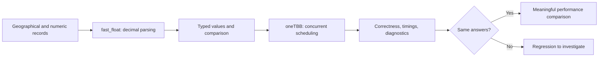

# CompareTest

## Live experiment: when parsing becomes a parallel workload

Imagine a large geographical data import: every row contains textual measurements, and a few bad numeric fields can invalidate a comparison. This laboratory separates **correct text-to-number conversion** from **throughput under parallel execution**. The point is not to claim that oneTBB is automatically faster; the point is to expose where parsing, memory access, scheduling and comparison actually consume time.

**What to demonstrate:** execute `compare-test` for the repeatable correctness and comparison path, then `compare-tune` for the available tuning workload. Compare the recorded processing time with the same data and workload, rather than comparing unrelated run sizes. If a parallel configuration is not present in a particular executable, do not infer a speedup from the name alone.

### The mathematical question

For `N` records and `p` workers, speedup and effective parallel efficiency are *measures to compute from observed timings*, not presumed properties:

$$
S(p)=\frac{T(N,1)}{T(N,p)},\qquad
E(p)=\frac{S(p)}{p}.
$$

Amdahl's law gives a theoretical upper bound when the serial fraction is `s`:

$$
S_{\mathrm{max}}(p)=\frac{1}{s+(1-s)/p}.
$$

Neither equation substitutes for measured data, and parsing accuracy must remain unchanged across execution strategies.

### Evidence and dependency chain

**Look for:** identical numeric outcomes, a documented input size, explicit timing units and no hidden change in parsing semantics. The BuildEngine package versions are fixed in the manifest; current timing measurements require a native execution.

---

**Test purpose:** Measures parsing and comparison throughput for numeric and geographic records with fast_float and oneTBB.

This independent BuildEngine-Tests project exercises **fast_float 8.2.3, oneTBB 2023.1.0** with native BCC64X/C++23 consumer code. Its source and its runtime dependency closure are defined by this directory's CMake/IDE configuration and the BuildEngine package catalog.

**Programs:** compare-test, optional compare-tune.

See [build.md](build.md), [LICENSE.md](LICENSE.md), [SBOM.md](SBOM.md) and the generated machine-readable CycloneDX declaration for each program. This page is test documentation, not a statement of verified production suitability.
