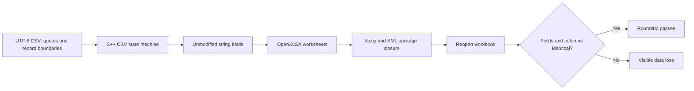

# CsvToXlsx — Description

## Demonstration: the spreadsheet that must not reinterpret your data

A CSV importer is deceptively dangerous: an account number beginning with zero, an input resembling an Excel formula, or a UTF-8 field containing a newline may be silently transformed when spreadsheet software guesses a cell type. Here **the text is the contract**. The converter accepts quoted CSV records, preserves heterogeneous field widths and writes a genuine OpenXLSX workbook without interpreting arbitrary strings as formulas, dates or numeric values.

**What to demonstrate:** use a CSV containing `"000123"`, a Unicode field, a quoted separator, a quoted line break and a formula-looking string. Convert it with `adecc_csv_to_xlsx`, open the result for visual inspection if desired, and run the separately registered `adecc_csv_to_xlsx_test` to check the automated roundtrip. A file that merely opens is not a sufficient correctness test.

### Preservation invariant

For every accepted field `f`, the intended roundtrip is a textual identity:

$$
\operatorname{ReadXlsx}(\operatorname{WriteXlsx}(f))=f.
$$

This assertion is about the *original character sequence* and column placement, not the floating-point equality of an inferred numeric value. Row width is variable, so the column index must also survive the conversion.

### From a byte stream to a real Office package

**Why this matters:** financial exports, product identifiers and regulatory records cannot tolerate silent type coercion. The parser and the OpenXLSX dependency are separate parts of the proof; this demonstration does not claim that every possible CSV dialect is supported.

---

**Test purpose:** Converts quoted UTF-8 CSV data with heterogeneous field widths to XLSX and verifies an exact data roundtrip.

Command-line CSV-to-XLSX batch converter for BuildEngine BCC64X. Every CSV field is handled as `std::string`, including leading zeros, arbitrary field widths and values that resemble formulas or dates. Records may have different numbers of columns and quoted fields may contain embedded record delimiters.

The application uses installed `OpenXLSX::OpenXLSX` packages. Its CSV parser does not require any third-party library. Two executables are built: the converter and a CTest consumer covering CSV interpretation, UTF-8 validation and a real XLSX roundtrip.

See [README.md](README.md) for semantics, error handling and limitations, and [build.md](build.md) for commands.
