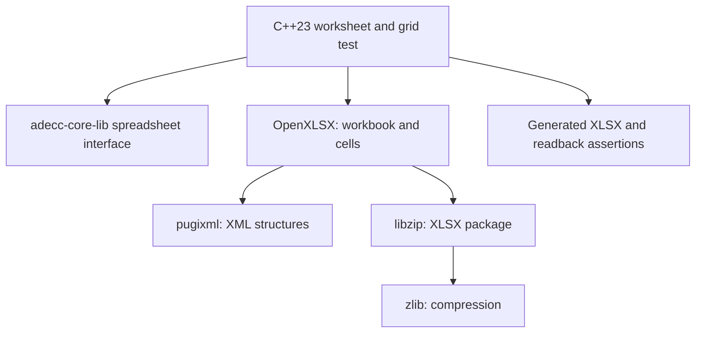

# OpenXLSX Grid and Worksheet Test

## Demonstration: an Excel workbook is a structured data model

The worksheet is more than a visual grid. A workbook contains typed cell values, coordinates, worksheets and a compressed XML package. This demonstration tests whether the **installed OpenXLSX implementation** and the independent adecc-core-lib spreadsheet interface can exchange real data without requiring Microsoft Excel or a live database.

**What to demonstrate:** run `adecc_openxlsx_grid_test`, inspect the generated XLSX file, and compare the values read back with those originally written. In particular, distinguish a cell's *address* from its *value type*; a successful file write does not establish correct data access unless the readback agrees.

### A simple invariant with two dimensions

Let `W(r,c)` be the value written at row `r` and column `c`, including its type. The roundtrip requires:

$$
\forall(r,c)\in D:\quad
\operatorname{ReadBack}(r,c)=W(r,c).
$$

The test additionally matters at worksheet boundaries: an off-by-one row or column error can preserve every value yet put them in the wrong business location.

### Exact package dependency map

**Scope:** this is an executable interface and persistence test, not an Excel GUI automation test. A native BCC64X run is required before reporting its final PASS status.

---

**Test purpose:** Validates worksheet cells, typed spreadsheet data, tabular access and XLSX roundtrip without Microsoft Excel.

This standalone C++23 test checks typed spreadsheet data access, worksheet operations, and XLSX file generation through the managed OpenXLSX library and the adecc-core-lib spreadsheet interface.

The test operates locally, without a database server or Microsoft Excel. It produces an XLSX file that can be inspected after execution and exercises the data-access abstractions with real worksheet content.

The CMake project resolves OpenXLSX, pugixml, libzip, Boost and zlib from the BuildEngine package catalog. See [build.md](build.md) for the exact commands, [SBOM.md](SBOM.md) for declared software inventory, and [LICENSE.md](LICENSE.md) for licensing.

**[not verified]** A fresh native Windows BCC64X test execution has not been performed as part of this documentation update.
