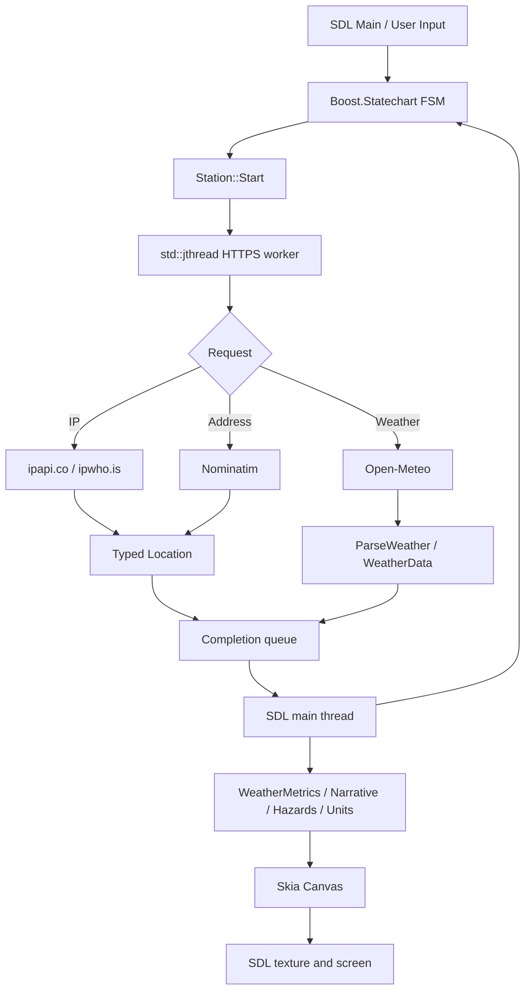
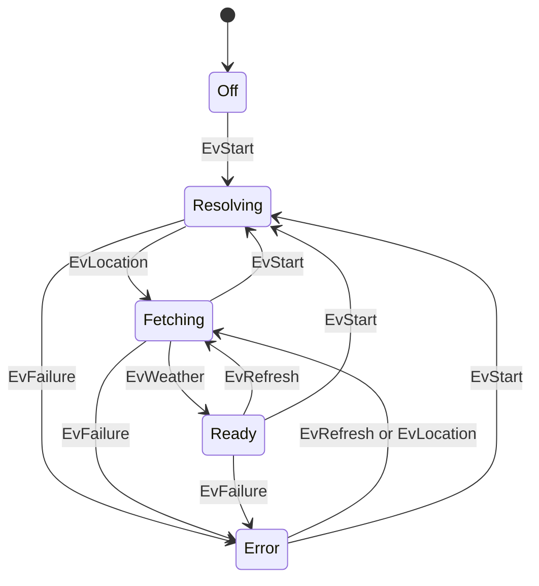

<!-- SPDX-FileCopyrightText: 2026 adecc Systemhaus GmbH -->
<!-- SPDX-License-Identifier: PolyForm-Noncommercial-1.0.0 -->

# WeatherClient: Architektur, Ablauf und Datenfluss

[TOC]

## Aufgabe und Abgrenzung

WeatherClient ist eine eigenständige, nichtkommerzielle C++23-Beispielanwendung innerhalb von BuildEngine-Tests. Sie **visualisiert** extern gelieferte Wetterdaten und Vorhersagen, sie erfasst keine meteorologischen Messungen und stellt keinen REST-Dienst bereit. Netzwerk, Parsing, Steuerung, Berechnung und Skia-Darstellung sind funktional getrennt. SDL2 verarbeitet Fenster und Eingaben, Skia rendert Rasterbilder, Boost.Statechart organisiert die Ablaufzustände.

Die ausführbaren Quellen liegen unter `WeatherClient/`; das Testverzeichnis wird unter dem Produktionsroot der BuildEngine erwartet. Die Anwendung wird als eigenständiger BCC64X-/CMake-/Ninja-Consumer der **installierten dynamischen** Bibliotheken gebaut. Versionswahl und DLL-Staging erfolgen über die BuildEngine-Mechanik, nicht über freie PATH-Suche oder hardcodierte Paketversionen.

## Komponenten und Verantwortlichkeiten

| Bestandteil | Aufgabe |
| --- | --- |
| `WeatherClient.cpp` | Einstiegspunkt, CLI-Modi, SDL-Ereignisse, FSM, Worker, Zeitsteuerung, Darstellung und Tests |
| `WeatherNetwork.h` | HTTPS via libcurl, Adress-/IP-Auflösung, Open-Meteo-Anfrage, lokale JSON-Konfiguration |
| `WeatherModel.h` | Typisiertes Wetter- und Standortmodell, JSON-Parser, Pflichtfeldprüfung, optionale Werte |
| `WeatherTime.h` | Absolute Viertelstunden-Grenzen, Retry-Termine, Zeigerwinkel der analogen Uhr |
| `WeatherUnits.h` | Metrische Quelldaten und spätere Celsius-/Fahrenheit-, km/h-/mph-, mm-/in-, hPa-/inHg-Ausgabe |
| `WeatherMetrics.h` | Tageslicht, Sonnenzeiten, UV-Kategorien und einfache Gewittersignale |
| `WeatherNarrative.h` | Englische Wetterzusammenfassung, kurzfristiger Trend, Windrichtungen |
| `WeatherHazards.h` | Erläuterbare 48-Stunden-Risikohinweise für Regen, Gewitter, Wind; keine amtlichen Warnungen |
| `WeatherMoon.h` | Näherungsweise Mondphase ohne zusätzliche API |
| `WeatherView.h` | Prognose, Bedienelemente, Trefferprüfung und Bedingungen |
| `WeatherArtwork.h` | Instrumente, Windrose, analoge Uhr und prozedurale Himmelsgrafik |
| `WeatherFont.h`, `WeatherText.h` | Systemschrift per Skia und eigene vektorbasierte Fallback-Glyphen |
| `WeatherDiagnostics.h` | Opt-in-Protokollierung von Rendering-Schritten |

## Ablauf beim Programmstart

1. `main` prüft Spezialmodi `--weather-probe`, `--self-test`, `--graphics-test` und `--fsm-test`; diese beenden sich ohne reguläre GUI-Schleife.
2. Im Normalmodus werden libcurl und SDL2 initialisiert; `--demo`, `--config` und `--ca-bundle` werden eingelesen. Standard-Konfiguration: `weather-location.json` im **aktuellen Arbeitsverzeichnis**.
3. Die Einheitenpräferenz wird geladen. SDL erzeugt ein skalierbares Fenster und einen Software-Renderer, Boost.Statechart wird initiiert.
4. Bei `--demo` wird ein fest codierter Teststandort und synthetisches Wetter verwendet, **ohne REST-Aufruf**.
5. Andernfalls wird eine gespeicherte und validierte Adresse geladen. Ist keine vorhanden, versucht der Client `ipapi.co`, danach gegebenenfalls `ipwho.is`. Beide liefern lediglich ungefähre Koordinaten.
6. Sobald Koordinaten vorhanden sind, startet der asynchrone Open-Meteo-Abruf für aktuelle Werte, stündliche Daten und sieben Tage.
7. Der Worker publiziert entweder Wetter-/Standortdaten oder eine Fehlermeldung. Die Hauptschleife übernimmt Ergebnisse, aktualisiert die FSM und zeichnet das Dashboard.

Eine im GUI ausdrücklich eingegebene Adresse wird **nur auf Benutzeraktion** über Nominatim gesucht. Nach erfolgreicher Auflösung wird sie im JSON persistiert. Eine IP-abgeleitete Näherung wird nicht allein zum Speichern der Einheiten als vollständige Benutzeradresse persistiert.

## Datenfluss

Es gibt keine HTTP-Verarbeitung im eigentlichen Skia-Zeichenaufruf. Daten und Fehler gelangen über die mit `std::mutex` geschützte `completed`-Queue zur UI-Schleife. Die monoton erhöhte `generation` identifiziert aktuelle Aufträge; veraltete Completions werden ignoriert.

**Aktuelle Implementierungsgrenze:** Wenn bereits ein `std::jthread` existiert, hält `Station::Start` den letzten neuen Auftrag in einer `pending`-Queue. `TickWorker` verknüpft das Einsammeln der Completion mit einem `join` und anschließendem Start des ausstehenden Auftrags. Diese Abfolge ist im aktuellen Code nachvollziehbar, jedoch nicht als umfassend last- oder race-getestet nachgewiesen. Sie darf nicht mit einer beliebig skalierbaren Request-Queue verwechselt werden.

## Endlicher Zustandsautomat

Der FSM-Test prüft definierte Zustandswechsel. Das allein ist **kein** Nachweis erfolgreicher Netzkommunikation oder paralleler Fehlerfreiheit. Auslöser sind insbesondere Start, erfolgreiche Standortauflösung, erfolgreiche Wetterdaten, manuelles und planmäßiges Refresh sowie Fehler.

## Viertelstunden, Fehler und Datenalter

Der Zielzeitpunkt einer erfolgreichen Aktualisierung wird mit `NextQuarterHour(system_clock::now())` berechnet, **nicht** als `now + 15 Minuten`. Geplante Grenzen sind `:00`, `:15`, `:30`, `:45`; die Grenze selbst ist exklusiv: Erfolg um 19:15:00 plant 19:30:00. Beim Fehler folgt eine neue Anfrage nach ungefähr einer Minute oder an einer vorher eintretenden Viertelstundengrenze. Bei laufendem Request wird kein zweiter HTTP-Aufruf parallel gestarted.

Der Abruf kann später abgeschlossen werden als der Grenzzeitpunkt. Angezeigt werden das lokale Status-Update und die vom Provider gelieferten Mess-/Forecast-Zeitstempel. **Ein neuer Abruf garantiert keine neue Modellrechnung des Wetterdienstes.** Die analoge Uhr basiert auf der lokalen Rechnerzeit; `timezone=auto` bezeichnet dagegen die Zeitzone der Wetterkoordinaten. Diese Zeiten dürfen bei entfernten Standorten voneinander abweichen.

Bei einem fehlgeschlagenen Wetterabruf bleiben zuvor erfolgreiche Wetterwerte gegebenenfalls sichtbar; `lastSuccessfulRefresh` wird nur bei einem übernommenen Wetterergebnis geändert. Fehler werden für die UI hinterlegt.

## Datenmodell, Interpretation und Anzeige

`WeatherCurrent` enthält u. a. Temperatur, gefühlte Temperatur, Taupunkt, relative Feuchte, UV, Luftdruck, Bewölkung, Niederschlag und Wind. `WeatherHour` enthält zusätzlich prognostische Niederschlagswahrscheinlichkeit und CAPE. `WeatherDay` enthält Min-/Max-Temperatur, Summen/Maxima und Sonnenzeiten. Viele Felder sind `std::optional`; fehlende Werte werden nicht zu Nullmessungen umdefiniert. Stündliche Daten werden auf die Zeit ab dem aktuellen gelieferten Stundenintervall begrenzt; täglich werden bis zu 16 Datensätze eingelesen, der HTTP-Aufruf fordert derzeit sieben Tage an.

Die Windrichtung von Open-Meteo bezeichnet die **Herkunft**, der animierte Richtungspfeil die **Bewegung** (`WindToDirection` addiert 180 Grad). Die Wetterübersicht unterscheidet metrische und US-Einheiten **bei der Darstellung**, ohne erneuten REST-Aufruf. Der UV-Index ist dimensionslos; die Kategorien LOW, MODERATE, HIGH, VERY HIGH und EXTREME entstehen lokal.

Die Tagesvorhersage zeigt Wetterbild, Min-/Max-Temperatur, Temperaturverlauf und Niederschlag. Die Sonnenauf- und -untergangszeiten stehen für den ausgewählten Tag im Kopfbereich, statt jede Spalte zu überladen. Die Nachtgrafik nutzt eine **approximierte** Mondphase, keine Ephemeriden-API.

## Lokale Hinweise auf Starkregen und Unwetter

`EvaluateHazards` betrachtet höchstens 48 stündliche Vorhersagedatensätze. Genutzte Indikatoren: Regen pro Stunde, **vollständige** sechs-Stunden-Regenfenster, WMO-Wettercodes, CAPE und Windböen. Beispielhafte Code-Schwellen sind mindestens 8/15/25 mm in einer Stunde, mindestens 20/35 mm über sechs vollständige Stunden und Böen ab 65/85/105 km/h. Gewittercode 95 wird höher bewertet, die Codes 96/99 als Gewitter mit Hagel. CAPE ab 1500 J/kg signalisiert Instabilität; daraus wird **keine Gewitterwahrscheinlichkeit** errechnet.

Die Ausgabe ist ein **Forecast-Modellhinweis**, keine amtliche Warnung und keine meteorologische Garantie. Fehlende Vorhersagedaten ergeben `N/A`, nicht fälschlich „kein Risiko“. Die genauen Implementierungsregeln sind in [WeatherHazards.h](WeatherHazards.h) und [WeatherServices.md](WeatherServices.md) dokumentiert.

## Interaktion und Dateilebenszyklus

| Aktion | Auswirkung |
| --- | --- |
| `ADDRESS` / `A` | Adresseingabe, Nominatim bei Bestätigung, Standort-/Wetterabruf |
| `IP LOCATION` / `I` | IP-Ortung und neuer Wetterabruf, Demo wird verlassen |
| `UPDATE` / `R` | Wetter neu abrufen, sofern ein Standort bekannt ist |
| `HOURLY` / `H`, `DAILY` / `D` | Zwischen Stunden- und Tagesdarstellung umschalten |
| Pfeile, Mausrad | Seitenweise Vorschau verschieben |
| `METRIC` / `US` / `U` | Ausgabeeinheiten ohne neuen Wetterabruf umschalten; Präferenz sichern |
| `FULL` / `F` / `F11` | Vollbild umschalten |
| `Esc` | Eingabe abbrechen oder Anwendung verlassen |

Die lokale JSON-Datei wird beim Ändern mit temporärer Datei und Rename geschrieben. Ihr Pfad ist über `--config <pfad>` konfigurierbar. Der Client legt keine zentrale Datenbank an und schreibt keine dauerhafte Historie der Wetterantworten.

## Build, Tests, Diagnose und externe Ressourcen

Siehe [build.md](build.md) für BCC64X-/CMake-Aufrufe, installierte DLL-Closure, `--self-test`, `--graphics-test`, `--fsm-test`, `--demo` sowie `--weather-probe`. Die REST-Endpunkte und manuell ausführbaren, TLS-geprüften `curl.exe`-Beispiele stehen in [REST.md](REST.md). Die direkt und transitiv deklarierten Bibliotheken samt Grenzen der SBOM-Verifikation stehen in [ThirdParty.md](ThirdParty.md).

Die Open-Meteo- und IP-Dienste unterliegen unabhängigen Nutzungsbedingungen. Die kostenlose Open-Meteo-Hosted-API ist nicht für den kommerziellen Einsatz freigegeben; Nominatim verbietet hochfrequente oder ungeeignete Nutzung seiner öffentlichen Instanz. Die Projektlizenz deckt keine Rechte an Diensten, Kartendaten oder Systemfonts ab; siehe [LICENSE.md](LICENSE.md) und [WeatherServices.md](WeatherServices.md).

**Verifikationsstatus:** Architektur und Ablauf aus den aktuellen Repository-Dateien auf `main` abgeleitet; kein lokaler BCC64X-Build, GUI-Test oder Live-Netzwerktest wird dadurch behauptet.
