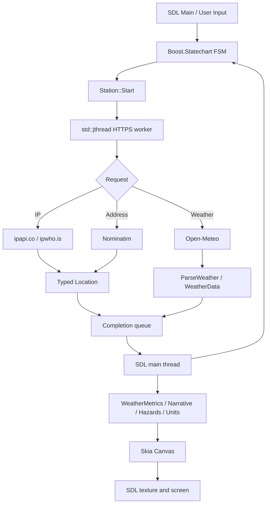
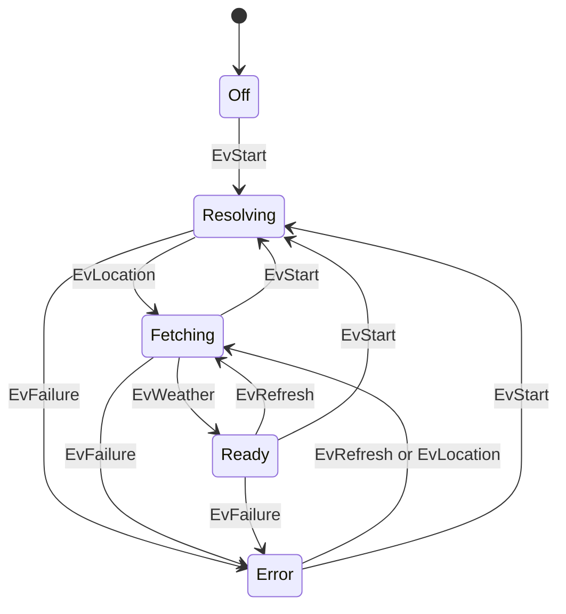

<!-- SPDX-FileCopyrightText: 2026 adecc Systemhaus GmbH -->
<!-- SPDX-License-Identifier: PolyForm-Noncommercial-1.0.0 -->

# WeatherClient: Architecture, Workflow, and Data Flow

[TOC]

## Purpose and Scope

WeatherClient is a standalone, non-commercial C++23 example in BuildEngine-Tests. It **visualizes** weather observations and forecasts supplied by third-party services. It neither measures weather locally nor exposes a REST server. Networking, parsing, application control, local calculations, and Skia rendering have separate responsibilities. SDL2 handles the window and input, Skia produces raster graphics, and Boost.Statechart defines the application states.

Sources reside in `WeatherClient/`. The test repository is expected to be located within the production BuildEngine root. WeatherClient is built with BCC64X, CMake, and Ninja as an independent consumer of **installed dynamic libraries**. Active package versions and DLL staging come from BuildEngine, not an arbitrary PATH search or hardcoded library versions.

**Language policy:** All application UI labels, generated messages, diagnostics intended for users, and project documentation are written in **English**. External API field names, library identifiers, and legally required original notices remain unchanged.

## Components and Responsibilities

| Component | Responsibility |
| --- | --- |
| `WeatherClient.cpp` | Entry point, command-line modes, SDL events, FSM, worker lifecycle, scheduling, rendering, and tests |
| `WeatherNetwork.h` | HTTPS through libcurl, address/IP resolution, Open-Meteo requests, and local JSON configuration |
| `WeatherModel.h` | Typed weather/location structures, JSON parsing, validation, and optional measurements |
| `WeatherTime.h` | Absolute quarter-hour boundaries, retry timing, and analog clock-hand angles |
| `WeatherUnits.h` | Metric source values and presentation conversions to °F, mph, inches, and inHg |
| `WeatherMetrics.h` | Daylight, sunrise/sunset times, UV categories, and basic storm signals |
| `WeatherNarrative.h` | English current-weather summary, short-term trends, and wind descriptions |
| `WeatherHazards.h` | Explainable 48-hour rain, thunderstorm, and wind indicators; **not official warnings** |
| `WeatherMoon.h` | Approximate Moon phase without a separate external API |
| `WeatherView.h` | Forecast presentation, controls, hit testing, and current conditions |
| `WeatherArtwork.h` | Instruments, unified wind panel, analog clock, and procedural sky |
| `WeatherFont.h`, `WeatherText.h` | Skia system-font use and original vector-glyph fallback |
| `WeatherDiagnostics.h` | Optional rendering diagnostics |

## Application Startup Sequence

1. `main` checks `--weather-probe`, `--self-test`, `--graphics-test`, and `--fsm-test`. These diagnostic modes do not run the normal application loop.
2. The normal mode initializes libcurl and SDL2, then reads `--demo`, `--config`, and `--ca-bundle`. The default settings file is `weather-location.json` in the **current working directory**.
3. The client loads display-unit preferences. SDL creates a resizable window and software renderer; Boost.Statechart is initialized.
4. With `--demo`, the application uses a fixed example location and synthetic weather data **without making REST calls**.
5. Otherwise, it reads a previously saved valid address. When none is available, it tries `ipapi.co` and, on failure, `ipwho.is`. Both provide only approximate coordinates.
6. Once coordinates are available, an asynchronous Open-Meteo request retrieves current conditions, hourly forecasts, and seven daily forecasts.
7. The worker publishes either weather/location data or an error. The main loop consumes the result, updates the FSM, and renders the dashboard.

An address explicitly entered in the GUI is resolved through Nominatim **only after user action**. A successfully resolved address is saved to the JSON settings file. An approximate IP-based location is not silently persisted as a confirmed street address.

## Data Flow

The Skia drawing functions do not perform HTTP requests. Data and errors are returned to the SDL thread via the `completed` queue protected by a `std::mutex`. A monotonically increasing `generation` value identifies requests, and stale completions are discarded.

**Implementation limitation:** If a `std::jthread` already exists, `Station::Start` keeps the latest request in its `pending` queue. `TickWorker` joins the previous worker only after a completion has been received, then launches the pending request. This behavior follows the current source code, but it is not evidence of exhaustive concurrency or load testing.

## Finite-State Machine

The FSM test validates defined state transitions; it does **not** establish successful HTTPS communication or the absence of native data races. Events represent startup, location resolution, weather retrieval, manual or scheduled updates, and failures.

## Quarter-Hour Refresh, Errors, and Data Freshness

After a successful request, the next target is computed by `NextQuarterHour(system_clock::now())`, **not** by adding 15 minutes to the previous request. The target boundaries are `:00`, `:15`, `:30`, and `:45`. These boundaries are exclusive: a completion at 19:15:00 schedules 19:30:00. After a failure, the client retries in approximately one minute, or at an earlier quarter-hour boundary. An already running network request is not duplicated concurrently.

A request may finish after the intended boundary. The UI distinguishes the system-local time of the last successful update from timestamps returned by the provider. **Fetching again does not guarantee a new provider model run.** The analog clock shows the computer's local time; `timezone=auto` describes the weather location's time zone. These can differ when viewing distant locations.

Previously successful weather data may remain visible after an HTTP error. `lastSuccessfulRefresh` is updated only when a successful weather result is accepted; failure details remain available to the UI.

## Weather Model, Interpretation, and Presentation

`WeatherCurrent` includes temperature, apparent temperature, dew point, relative humidity, UV index, pressure, cloudiness, precipitation, and wind. `WeatherHour` additionally carries precipitation probability and CAPE. `WeatherDay` includes minimum/maximum temperature, daily totals, maxima, sunrise, and sunset. Many fields are `std::optional`; missing readings are not silently converted to zero. The hourly model is filtered by the returned time sequence; the daily parser supports up to 16 entries, while the current HTTP request asks for seven days.

The Open-Meteo wind direction specifies **where the wind comes from**; the arrow points **where it travels** (`WindToDirection` adds 180 degrees). The wind panel displays direction, speed, and gusts in separate rows without a redundant miniature compass. Metric/US conversion happens **at presentation time**, without an additional REST request. The UV index is dimensionless and is assigned local exposure categories: LOW, MODERATE, HIGH, VERY HIGH, and EXTREME.

The daily forecast shows weather symbols, temperature minima/maxima, curves, and precipitation. Sunrise and sunset for the selected day appear in the header instead of being repeated in every forecast column. The nighttime Moon display uses an **approximation**, not a precision ephemeris service.

## Local Heavy-Rain and Severe-Weather Indicators

`EvaluateHazards` examines at most 48 hourly forecast entries. Inputs include hourly rain amounts, **complete** six-hour accumulation windows, WMO weather codes, CAPE, and gust speeds. Example code thresholds are 8/15/25 mm in one hour, 20/35 mm in six complete hours, and gusts of 65/85/105 km/h. Weather code 95 signals a thunderstorm; 96/99 indicate thunderstorms with hail. CAPE at or above 1500 J/kg indicates instability and is **not** treated as a numerical thunderstorm probability.

The result is a **forecast-model indicator**, not an official alert or meteorological guarantee. Missing forecast data produces `N/A`, not a false low-risk classification. See [WeatherHazards.h](WeatherHazards.h) and [WeatherServices.md](WeatherServices.md) for implementation details.

## Controls and Local File Lifecycle

| Control | Behavior |
| --- | --- |
| `ADDRESS` / `A` | Enter an address; confirm to query Nominatim and refresh weather |
| `IP LOCATION` / `I` | Resolve approximate IP location and refresh live data; leave demo mode |
| `UPDATE` / `R` | Refresh weather for a known location |
| `HOURLY` / `H`, `DAILY` / `D` | Switch forecast resolution |
| Arrow keys / mouse wheel | Navigate forecast entries |
| `METRIC` / `US` / `U` | Switch presentation units without fetching new weather; save preference |
| `FULL` / `F` / `F11` | Toggle full-screen display |
| `Esc` | Cancel editing or exit the application |

When modified, the local JSON settings are written using a temporary file and rename. The path can be changed with `--config <path>`. WeatherClient does not create a database or store a persistent history of provider responses.

## Build, Diagnostics, Third Parties, and Licensing

See [build.md](build.md) for BCC64X/CMake commands, runtime staging, `--self-test`, `--graphics-test`, `--fsm-test`, `--demo`, and `--weather-probe`. [REST.md](REST.md) documents HTTPS endpoints and independent `curl.exe` examples. [ThirdParty.md](ThirdParty.md) distinguishes direct software dependencies, declared package roots, and the **unverified** binary dependency closure.

The Open-Meteo and IP/geocoding services have separate usage terms. The free hosted Open-Meteo API is intended for non-commercial use; public Nominatim prohibits unsuitable or high-frequency access. The project license does not grant rights to third-party API services, geographic data, or system fonts. See [LICENSE.md](LICENSE.md) and [WeatherServices.md](WeatherServices.md).

**Verification:** This page reflects reviewed source and CMake files on `main`. It does not claim that a local BCC64X build, GUI test, or live network test was run.
