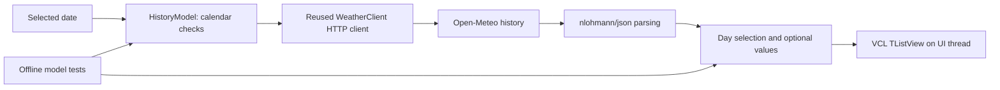

# WeatherHist description

## Demonstration: revisiting a day without inventing observations

Historical weather is a provenance problem: a table may contain hourly values, a selected daily statistic or a value not supplied by the provider at all. This native VCL viewer retrieves one-day historical data from Open-Meteo and deliberately separates **request parameters, JSON decoding, selected-date aggregation and user-interface updates**.

**What to demonstrate:** choose a historical date and inspect the two-column results. Notice where a value is absent rather than silently replaced. The offline `HistoryModelTests.cpp` checks date validity, local-noon selection, day totals and UV-data provenance without a network connection.

### Aggregation is not an observation

For an additive hourly quantity such as the precipitation represented by valid hourly amounts `p_i`, a day total is mathematically:

$$
P_{\mathrm{day}}=\sum_{i\in\mathrm{selected\ day}}p_i.
$$

This is distinct from a single measurement sampled near local noon. The displayed quantity must carry its correct aggregation meaning and unit. The project tests that distinction, not the accuracy of an external weather archive.

### Runtime and validation boundaries

**Limits:** a passing offline test proves date selection and aggregation logic, not current provider availability. TLS and the BuildEngine-managed curl/OpenSSL runtime remain part of the live path.

---

**Test purpose:** Displays historical daily weather, selected-date aggregates and UV provenance with model validation.

WeatherHist provides a minimal native VCL front-end for one-day Open-Meteo historical weather. It isolates API parsing and date validation from VCL in `HistoryModel.h` and reuses WeatherClient's HTTP and address lookup implementation rather than introducing another HTTP client. `HistoryModelTests.cpp` validates local-noon selection, day totals, optional values, UV provenance and invalid dates. The result view is a two-column VCL TListView; user interaction and UI updates run on the VCL thread. No files are downloaded or saved persistently.

The linked library is the BuildEngine curl DLL, with OpenSSL, zlib, Brotli and Zstandard runtime roots declared. nlohmann/json is an installed header-only package. Native VCL and BCC64X runtime packages come from RAD Studio.
