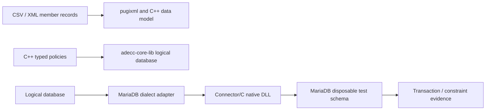

# MariaDB integration tests

## Showcase experience and scientific context

A transaction is a promise that either a group of changes becomes visible together or none of it does. This laboratory takes that promise out of the textbook and tests it against a real MariaDB server through the installed Connector/C DLL and the shared adecc-core-lib logical database tests. The same test model is reused for other SQL dialects, so backend behavior can be compared without inventing a separate business test for every driver.

### What the operator should see

Run the offline parameter-scanner checks first, then use a **disposable** `BuildEngineTest` database for the connection and member-pipeline tests. Observe insertion of valid tuples, intentional primary-key/CHECK violations, transaction state and the XML/CSV membership import. The test creates and drops objects, so a production database is not appropriate.

### Mathematics and invariants

Relational keys express a uniqueness invariant. For a key function \(k\) and distinct stored tuples \(a,b\):

$$
a\ne b\ \Longrightarrow\ k(a)\ne k(b).
$$

A failed insert must leave committed data unchanged according to the active transaction's rules. A valid parsed field is not the same thing as a valid row: database constraints are the final enforcement boundary.

### Execution and managed dependency flow



### What this does not prove

The online test depends on a running server and permissions. Integrated login is explicitly unsupported in this adapter; offline parsing is not evidence of an authenticated connection.

---


**Test purpose:** Validates parameter handling, relational constraints, transaction behavior and XML/CSV membership import.

The native BCC64X MariaDB Connector/C 3.4.11 package and updated `adecc-core-lib` physical query backend support the **unchanged** common test in `database/common/additional_tests.h`. The dialect adapter is `additional_dialect.h` and uses MariaDB InnoDB and a CHECK constraint.

## Command-line options

```text
adecc_mariadb_logical_test.exe [--host HOST] [--port PORT] [--database DB] [--user USER] [--password PASSWORD] [--ca CA_FILE] [--offline] [--integrated] [--no-tls]
```

Defaults: `--host localhost`, `--port 3306`, `--user root`, `--database BuildEngineTest`. Options override their respective `BUILDENGINE_MARIADB_HOST`, `BUILDENGINE_MARIADB_PORT`, `BUILDENGINE_MARIADB_USER`, `BUILDENGINE_MARIADB_DATABASE`, `BUILDENGINE_MARIADB_PASSWORD` and `BUILDENGINE_MARIADB_CA` environment variables.

`--password` works but exposes a secret to process listings and shell history. Prefer setting `BUILDENGINE_MARIADB_PASSWORD` securely in the test environment. The `--integrated` switch currently fails explicitly because GSSAPI is not yet implemented/verified in the connection adapter. There is no silent password fallback.

The shared test **creates and drops** `Test_Error_TupleInsert` in the specified database. Use a disposable test database with appropriate rights; never point it at production. The minimum user account is appropriate DDL/DML access to that test schema. `root` is a default for convenience, not the recommended test account.

## Build

```bat
cmake -S database/mariadb -B ../build/Test/database/mariadb/Release/cmake -G Ninja -C bootstrap/BuildEngineInit.cmake -DCMAKE_BUILD_TYPE=Release -DBUILDENGINE_CONFIGURATION=Release -DCMAKE_INSTALL_PREFIX=../build/Test/database/mariadb/Release
cmake --build ../build/Test/database/mariadb/Release/cmake
ctest --test-dir ../build/Test/database/mariadb/Release/cmake --output-on-failure
cmake --install ../build/Test/database/mariadb/Release/cmake
..\build\Test\database\mariadb\Release\adecc_mariadb_logical_test.exe --database BuildEngineTest --user root
```

Offline tests verify the parameter scanner without contacting a server. Real BCC64X compile and MariaDB 11 execution remain pending; no PASS is claimed until logs are supplied.
