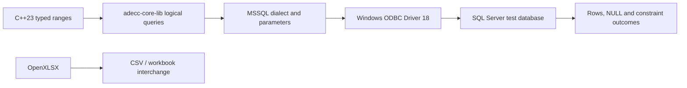

# Microsoft SQL Server data access and transaction tests

## Showcase experience and scientific context

A relational model should retain its meaning when the physical provider changes. This experiment drives typed results, named parameters, lazy result ranges and SQL constraints through Windows ODBC Driver 18 into SQL Server. It contrasts the general logical data-access contract with the very particular behavior of the Microsoft SQL dialect and driver.

### What the operator should see

Run the native ODBC consumer and the shared `adecc_mssql_additional_test` against a dedicated `BuildEngineTest` database. Watch valid records move through a typed range, then inspect deliberate duplicate-key, NULL and CHECK failures. The CSV/XLSX pipeline forms a separate interchange path rather than a substitute for SQL constraint evidence.

### Mathematics and invariants

An intended all-or-nothing transaction has two allowed external outcomes for a set of changes \(\Delta\):

$$
\operatorname{Commit}(\Delta)\in\{\text{all changes visible},\ \text{none visible}\}.
$$

The guarantee is conditional on the actual transaction boundaries used by the test. An iterator over result rows must not fabricate NULL values or silently coerce them to numbers.

### Execution and managed dependency flow

### What this does not prove

Requires a real SQL Server and separately installed Microsoft ODBC Driver. The suite may create or drop test tables; do not run against production.

---

**Test purpose:** Exercises ODBC SQL Server access, typed result ranges, transactions, constraint errors and CSV/XLSX processing.

This project exercises the Windows ODBC Driver 18 connection to SQL Server, typed C++ result ranges, relational constraints, transactions, CSV processing and XLSX integration. The tests use the independently maintained adecc-core-lib database and spreadsheet interfaces.

Two scenarios are implemented: the direct SQL Server consumer and a common logical-database test suite with backend-specific SQL dialect configuration. Integration runs require a dedicated `BuildEngineTest` database; never use a production database because tests may create and drop their own objects.

Dependencies include managed OpenXLSX, pugixml, libzip, Boost, zlib, xz, zstd and OpenSSL, plus the system-installed Microsoft ODBC Driver and a running SQL Server. Follow [Configure.md](Configure.md) for access setup and [build.md](build.md) for configure, build, CTest and execution commands.

## Supplementary MSSQL headers

## Configuration

See [Configure.md](Configure.md) for the Windows login, database user, permissions and SQL Server service.

## Additional shared database executable

`adecc_mssql_additional_test` instantiates [common/additional_tests.h](../common/additional_tests.h) against this backend's `logical_database`. The common suite currently covers source-derived tuple OutputRange, NULL, named parameters, lazy Execute ranges, primary key and CHECK failures. Only [additional_dialect.h](additional_dialect.h) creates the native schema. Supplemental reference headers are retained under [common/original](../common/original/) for further migration; not all original cases are enabled yet. No JSON/XML fixture is required by the currently enabled tests.
