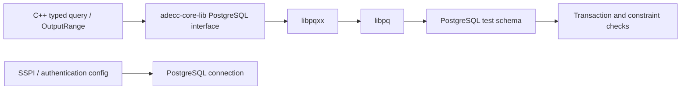

# PostgreSQL typed query and transaction tests

## Showcase experience and scientific context

Follow a C++ query from a strongly typed input through libpqxx and libpq to a PostgreSQL transaction. The point is not simply to establish a connection: it is to show that transaction scopes, constraints, NULL handling and lazy result processing survive the passage between the compile-time model and a physical database.

### What the operator should see

Use the configured `BuildEngineTest` database, run the native pqxx consumer and the shared additional test. Compare valid parameter-bound queries with intentionally invalid constraint cases. Observe SSPI/GSSAPI or explicitly configured password authentication, and distinguish an authentication error from a database integrity error.

### Mathematics and invariants

A referential constraint is a logical inclusion rule for stored keys:

$$
\pi_{\mathrm{foreign\ key}}(R)\setminus\{\mathrm{NULL}\}\subseteq\pi_{\mathrm{primary\ key}}(S).
$$

Not all such constraints are implemented by this individual test: its directly exercised common suite includes primary-key and CHECK failures. The equation explains the broader integrity model without claiming additional coverage.

### Execution and managed dependency flow

### What this does not prove

SSPI configuration and database permissions are environment-dependent. Only the actually enabled shared test cases are covered; archived sample headers are not executable evidence.

---

**Test purpose:** Validates libpq/libpqxx queries, SSPI authentication, result ranges, transactions and database constraints.

This project checks native libpq and libpqxx consumers, typed C++ query result ranges, parameter binding, transaction semantics, constraints and shared logical-database operations through adecc-core-lib.

Tests use a dedicated `BuildEngineTest` PostgreSQL database and may create or drop their own objects. A PostgreSQL server with configured SSPI/GSSAPI or password authentication is required for live integration; no production database should be targeted.

Managed library roots include libpq, libpqxx, OpenSSL, zlib, Brotli and zstd. Follow [Configure.md](Configure.md) for PostgreSQL access configuration and [build.md](build.md) for reproducible BCC64X build and execution commands.

## Configuration

See [Configure.md](Configure.md) for Windows SSPI, user mapping through pg_hba.conf/pg_ident.conf and separate database roles.

## Additional shared database executable

`adecc_postgresql_additional_test` instantiates [common/additional_tests.h](../common/additional_tests.h) against this backend's `logical_database`. The common suite currently covers source-derived tuple OutputRange, NULL, named parameters, lazy Execute ranges, primary key and CHECK failures. Only [additional_dialect.h](additional_dialect.h) creates the native schema. Supplemental reference headers are retained under [common/original](../common/original/) for further migration; not all original cases are enabled yet. No JSON/XML fixture is required by the currently enabled tests.
