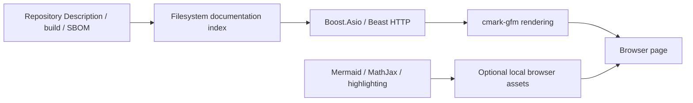

# BuildEngine-Tests Markdown documentation server

## Showcase experience and scientific context

This project is a miniature proof that documentation is a software product, not a collection of loose Markdown files. A native C++23 loopback HTTP service walks the repository documentation, renders GitHub-flavored Markdown through installed cmark-gfm DLLs, and loads optional Mermaid, MathJax and syntax-highlighting assets only for pages that require them.

### What the operator should see

Open the local documentation service and navigate between test descriptions, build instructions, licenses and CycloneDX inventories. Inspect a Mermaid diagram and a MathJax equation in a project page. Follow a source link to the read-only syntax-highlighted viewer; the server exposes source text, never a source-execution endpoint.

### Mathematics and invariants

The service separates an input document from its presentation:

$$
\operatorname{HTML}=\operatorname{Render}_{\mathrm{cmark\mbox{-}gfm}}(\operatorname{Markdown}),
$$

with optional browser presentation layers selected by document features. The equation is an architectural description, not a cryptographic integrity claim.

### Execution and managed dependency flow

### What this does not prove

The server is a local test-support application and does not offer a BuildEngine command endpoint. It does not establish the legal completeness of licenses merely by rendering them.

---

**Test purpose:** Verify a standalone BCC64X C++23 HTTP documentation server that renders Markdown, navigates grouped test projects, serves syntax-highlighted source, and checks project documentation and declared CycloneDX inventories.

This is a standalone **test-support application**, not a production-facing API. It renders repository Markdown directly with a cmark-gfm DLL and serves independently prepared JavaScript/CSS and image resources. Navigation groups the library-consumer tests, including Description, build, licenses and SBOM declarations. Feature-dependent syntax highlighting, Mermaid diagrams and MathJax are loaded only when needed.

The server runs on loopback by default. It exposes no build execution endpoint.

**Libraries exercised:** Boost.Asio/Beast (HTTP), cmark-gfm and cmark-gfm extensions (Markdown), Windows socket runtime. Browser assets: highlight.js, Mermaid, MathJax.

[Build instructions](build.md) · [License](LICENSE.md) · [SBOM](SBOM.md).

## Database navigation

The server recursively indexes `database/`, including `database/common`, MSSQL and PostgreSQL. Parent sections do not generate non-existent license/SBOM links. The shared C++ and original Test.zip headers as well as backend SQL creation scripts can be viewed in the read-only syntax-highlighted source viewer; they cannot be executed by the server.
