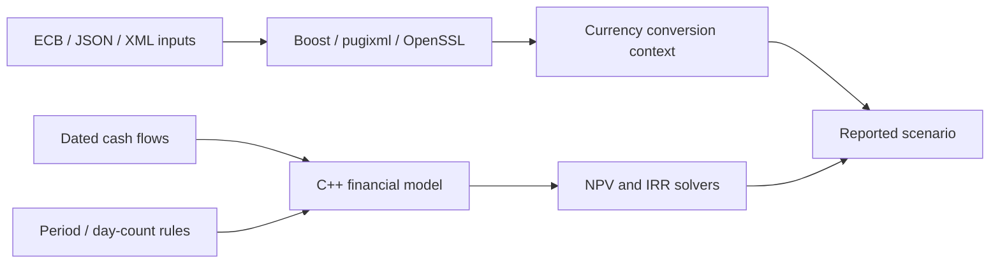

# Financial demonstrations

## Showcase experience and scientific context

Financial results can change dramatically with assumptions that look harmless: timing, reinvestment, compounding conventions, currency conversion date and the existence of multiple return roots. The native demonstration links the financial calculation library with XML/JSON handling and optionally external exchange-rate material. It makes the distinction between mathematical cash-flow results and provider-supplied data explicit.

### What the operator should see

Run `financial_demo` and inspect the investment/cash-flow scenarios, annualization choices and currency figures. Where internal-rate-of-return scenarios are exercised, compare the selected root with the residual rather than treating a printed percentage as proof. The implementation contains iterative solvers and bisection/interval-scan support; real scenario coverage must be checked in the associated test output.

### Mathematics and invariants

For cash flows \(C_t\) at periods \(t=0,\ldots,n\), internal rate of return is a root of net present value:

$$
\operatorname{NPV}(r)=\sum_{t=0}^{n}\frac{C_t}{(1+r)^t}=0,\qquad r>-1.
$$

Newton iteration uses

$$
r_{k+1}=r_k-\frac{\operatorname{NPV}(r_k)}{\operatorname{NPV}'(r_k)}.
$$

A residual near zero is necessary but **not** proof of a unique economically meaningful root; changes of sign in the cash-flow sequence can create multiple candidates.

### Execution and managed dependency flow

### What this does not prove

Numerical models are not financial advice, a live ECB quote or proof of future returns. Provider results and production validation require separate evidence.

---

**Test purpose:** Evaluates investment fund returns, multi-currency cash flows, financial calculations and XML/JSON data interchange.

This independent BuildEngine-Tests project exercises **Boost, pugixml, OpenSSL, zlib, brotli, zstd** with native BCC64X/C++23 consumer code. Its source and its runtime dependency closure are defined by this directory's CMake/IDE configuration and the BuildEngine package catalog.

**Programs:** financial_demo.

See [build.md](build.md), [LICENSE.md](LICENSE.md), [SBOM.md](SBOM.md) and the generated machine-readable CycloneDX declaration for each program. This page is test documentation, not a statement of verified production suitability.
