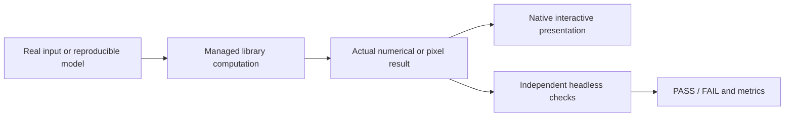

# Native graphics demonstration gallery

This directory groups ten independent **interactive Windows C++23/BCC64X applications**, each with readable controls, animated scenarios, a headless correctness test and optional independent presentation artifacts.

## Curated journeys through the laboratory

The goal is to make **real computation visible**. Each showcase connects a scientific question to an installed library, a genuine numerical/image/audio result and a reproducible test. Begin with the effect, study its equation and dependency graph, then inspect the verification status.

| Journey | Open the experience | What becomes visible |
| --- | --- | --- |
| Light and inverse problems | [HDR Photon Observatory](hdr-photon-observatory/Description.md) | Floating-point OpenEXR radiance and real Ceres calibration |
| Nonlinear worlds | [Matplot++ Chaos Atlas](matplot-chaos-atlas/Description.md) | Six maps and parametrized curves sampled by Matplot++ |
| Walkable geometry | [Navigation Reactor](navigation-reactor/Description.md) | Real 3D Recast geometry and Detour corridor |
| From a curved page to words | [Tesseract OCR Studio](tesseract-ocr-studio/Description.md) | OpenCV remap and authentic Tesseract recognition |
| Similarity becomes light | [Vector Galaxy](vector-galaxy/Description.md) | hnswlib neighbor IDs and libigl surface normals |
| Hearing the mathematics | [Pulse Engine](pulse-engine/Description.md) | miniaudio PCM waveforms, measured RMS, optional speakers |
| A message becomes a symbol | [Barcode Signal Lab](barcode-signal-lab/Description.md) | Native Zint/ZXing encode-decode roundtrip |

### The evidence pipeline

An inverse problem such as HDR sensor fitting minimizes a residual:

$
\min_{\theta}\;\frac12\sum_{i=1}^{N}\bigl(y_i-f(x_i;\theta)\bigr)^2.
$

Other exhibits use iterated nonlinear maps, signal synthesis, computer vision or geometry. Their exact equations and known limits are now included on each project page. **Not verified** always means no completed native BCC64X runtime acceptance evidence is being claimed.

| Showcase | Native user experience | Managed libraries |
| --- | --- | --- |
| [Dear ImGui Neon Laboratory](imgui-neon-lab/Description.md) | Four time-dependent particle fields, scene selection, zoom and playback controls | ImGui, SDL2 |
| [ImPlot Real-Time Signal Theater](implot-signal-theater/Description.md) | Four oscilloscope models, animated ImPlot curves, labeled axes, signal toggles and parameter sliders | ImPlot, ImGui, SDL2 |
| [Matplot++ Mathematical Discovery Gallery](matplot-chaos-atlas/Description.md) | Six tiled mathematical scenes, detailed progressive animation, zoom and optional six-file SVG export | Matplot++, ImGui, SDL2 |
| [Vector Galaxy](vector-galaxy/Description.md) | 851-star mathematical nebula with real HNSW similarity rings and libigl vertex-normal lighting | hnswlib, libigl, Eigen, ImGui, SDL2 |
| [Barcode Signal Lab](barcode-signal-lab/Description.md) | Universal barcode laboratory with five writer formats, real external Zint encoding and native ZXing round-trip decoding | ZXing-C++, Zint, ImGui, SDL2 |
| [OpenCV Barcode Vision](opencv-barcode-vision/Description.md) | Native OpenCV/ZXing barcode and ISBN recognition, DirectShow cameras, asynchronous Open Library/Google Books REST metadata and cover preview | OpenCV, ZXing-C++, Zint, ImGui, SDL2 |
| [Tesseract OCR Studio](tesseract-ocr-studio/Description.md) | Selectable HD/4K DirectShow camera, full-page or cropped German/English Tesseract OCR, native OpenCV document rectification and copyable text | Tesseract, Leptonica, OpenCV, ImGui, SDL2 |
| [Navigation Reactor](navigation-reactor/Description.md) | Real Recast triangle classification and voxelized heightfields; interactive slope and relief controls | Recast Navigation, ImGui, SDL2 |
| [Pulse Engine](pulse-engine/Description.md) | Glowing PCM oscilloscope, four true miniaudio oscillators, optional audible sound synthesis | miniaudio, ImGui, SDL2 |
| [HDR Photon Observatory](hdr-photon-observatory/Description.md) | Interactive HDR photon fields, genuine OpenEXR round-trip, Ceres nonlinear calibration, exposure and sensor visualization, headless numerical checks | Ceres Solver, OpenEXR, Imath, ImGui, SDL2 |

Each application builds independently with CMake/Ninja, uses installed BuildEngine DLLs, and provides one-line build commands in its own `build.md`. The graphic is part of the native application, **not** a browser rendering of pre-generated SVGs. The central server can additionally display independently generated SVGs when available.

**[not verified]** The revised interactive GUI code requires native Windows BCC64X compilation and a visual desktop verification. Existing library smoke tests remain unchanged.
