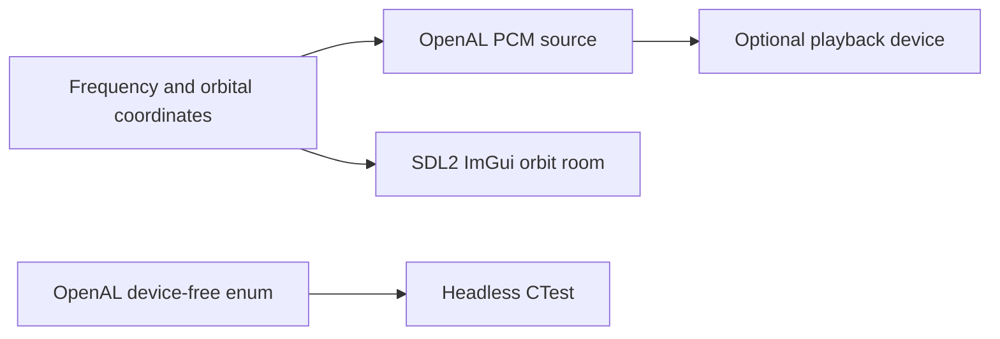

# Acoustic Orbitarium — Sound in Space

*Original concept illustration; not a native screenshot.*

## An immersive acoustics expedition

Navigate a glowing orbital listening chamber. The virtual listener sits at the origin while a real OpenAL source travels around an adjustable orbit. Change the radius and azimuth to explore positional cues. Opening a physical device requires clicking **OPEN DEVICE / PLAY SPATIAL SOUND**: no output device opens by default.

## Mathematical foundations

A circular source trajectory with radial distance \(r\) and azimuth \(\theta\) is

$$\mathbf p=(r\cos\theta,0,r\sin\theta),\qquad x[n]=A\sin(2\pi f n/f_s).$$

Real PCM samples are uploaded through the installed OpenAL `alBufferData`; native `alSource3f` moves the actual audio source relative to the listener. The orbit lines are explanatory visualization, not psychoacoustic measurements.

## Pipeline

## Acceptance and safety

`--verify` checks the actual installed OpenAL API without opening a sound device. GUI audio is opt-in; the RAII audio scene releases device, context, source and buffer on stop or application exit. F1 shows About; F11 toggles fullscreen using the shared application adapter.

## Desktop concept

*Concept, not a screenshot. Replace only after a native application capture.*

**[not verified]** Native BCC64X compilation, Windows device playback and CTest execution remain pending.