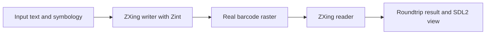

# Barcode Signal Lab — Universal Encode / Decode

## Scientific showcase: experience and mechanisms

### What the visitor experiences

A barcode is a constrained encoding, not merely stripes. The installed ZXing writer and external Zint DLL generate real pixels; the independent ZXing decoding path recovers the text and reports exact roundtrip evidence.

### Demonstration sequence

Choose QR, Data Matrix or EAN-13, encode a valid payload and compare the readback with the input. Inspect why invalid length, digits or checksum lead to an explicit error.

### Mathematical background

$$c=\left(10-\sum_{i=1}^{12}w_i d_i\bmod 10\right)\bmod 10,\quad w_i=1\ (i\text{ odd}),\ 3\ (i\text{ even}).$$

The equation describes the relevant mathematical mechanism, rather than independently proving any performance, physical fidelity or runtime success.

### Native pipeline and managed dependencies

The diagram describes data responsibilities. BuildEngine-managed libraries remain versioned package dependencies; a successful visual display cannot replace the declared headless correctness checks.

---

## Experience

Choose **QR Code, Data Matrix, Aztec, PDF417, Code 128, Code 39, Code 93, Codabar, ITF, EAN-13, EAN-8 or UPC-A**, enter a payload, press **ENCODE + SCAN**, and watch the resulting barcode appear. A native ZXing-C++ reader independently decodes the generated pixel image and the application reports the actual recovered text and round-trip status. The rendering is based on pixels returned by the writer, not a painted imitation.

## Integration

The installed **ZXing-C++ 3.1.1** DLL uses the upstream new writer backend with **external Zint 2.16.0** instead of a bundled encoder. A call to `ZBarcode_ValidID` additionally exercises the independent Zint DLL. Both shared libraries must be present and version-coherent. The live GUI is implemented with the existing ImGui and SDL2 packages.

`ZXing::CreateBarcodeFromText` creates a selected symbol; `ZXing::WriteBarcodeToImage` produces its bitmap; `ZXing::ReadBarcodes` interprets that image. Generated bitmap pixels are converted into ImGui draw rectangles for a sharp native display. The application is offline and does not fetch a second barcode backend.

The twelve selectable formats represent explicit tested use cases, not a promise that every conceivable barcode symbology accepts every arbitrary payload. For EAN-13, supply valid numeric content and checksum.

## Verification

The `--verify` CTest runs all twelve format round-trips and checks the Zint DLL capability, image dimensions and successful returned payloads. It prints `SHOWCASE|CHECK` and `SHOWCASE|RESULT` evidence. Invalid payloads are reported instead of silently generating another barcode.

**[not verified]** The modified reader/writer DLL, native barcode laboratory compilation, screenshot and full multi-format CTest still require Windows BCC64X execution.

## Writer backend and executable identity

The native implementation uses ZXing's **new writer API**, linked against the separately installed Zint shared library. It does not use an independently generated demonstration symbol or a reader-only fallback. A missing or invalid writer is an explicit error. Changing the symbology loads a matching sample payload; EAN/UPC and ITF require numeric payloads and can impose length/check digit constraints. The CTest checks the 12 example payloads.

If a running application still reports "no write backend" or mentions independently generated barcodes, confirm its executable path: these strings do not occur in this `main.cpp`. Running `cmake --build` updates the build-tree runtime binary, **not** necessarily the separately installed application. Reconfigure, build, test and install, then launch the documented installed executable. This explanation is not proof that an older executable was used.

## Compact input and readback UI

The editable content field is presented with a dedicated heading and a wide text box. Press Enter or **ENCODE + SCAN** to generate a barcode and immediately decode it. The view displays the exact last successfully encoded payload, returned decoded texts and PASS/FAIL status *above* the barcode; editing input alone never changes the claimed encoded value. Generation errors clear the previous result. The visualization is limited to a 480 by 300 pixel panel (or narrower as available) rather than the previous 1080 by 440 panel, keeping the input and readback on screen for QR Code as well as linear symbols. The symbol itself is scaled proportionally.

**[not verified]** Native visual placement and the 12-format Windows test still require a local BCC64X run.
