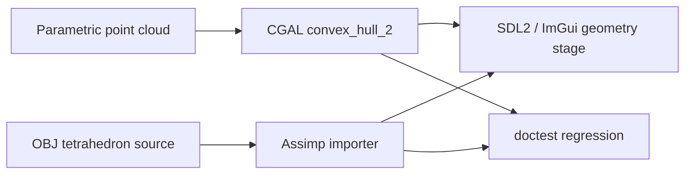

# Geometry Cathedral — The Shape of Space

*Generated concept illustration, not native output.*

## Live mathematical spectacle

360 points spiral across the laboratory; their convex envelope is computed with the installed **CGAL 6.2.1** geometric algorithm and traced in gold above the original cyan point cloud. Simultaneously, **Assimp 6.0.6** imports a genuinely triangulated tetrahedral OBJ mesh from memory and exposes scene-graph/face counts. **doctest 2.4.12** independently verifies real API behavior.

## Mathematics

For a finite point set \(P\subset\mathbb R^2\), its convex hull is the smallest convex set containing every point:

$$\operatorname{conv}(P)=\left\{\sum_{i=1}^n\lambda_i p_i\mid\lambda_i\ge0,\ \sum_i\lambda_i=1\right\}.$$

The independent predicate test also verifies \(d^2((0,0),(3,4))=25\). The hull is not a decorative polyline: vertices come directly from CGAL.

## Dependency architecture

## Verification and controls

Run `--verify` without opening a window to execute doctest cases for CGAL convex hull, exact squared distance and Assimp mesh/face topology. F1 About and F11 fullscreen are provided by the shared native adapter.

## Provisional desktop concept

*Concept only, not an application screenshot. Replace with verified native capture.*

**[not verified]** New native BCC64X compilation, GUI and CTest acceptance are pending.