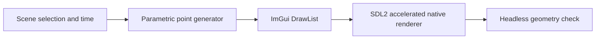

# Dear ImGui Neon Constellation

## Scientific showcase: experience and mechanisms

### What the visitor experiences

Four living parametric scenes demonstrate actual native ImGui DrawList particles and SDL2 font-atlas output. Nebula Vortex, Quantum Orbit, Wave Interference and Stellar Bloom are distinct coordinate laws, not static assets.

### Demonstration sequence

Switch all four scenes, pause, resume, adjust zoom and resize. Compare actual moving particle geometry and legible text.

### Mathematical background

$$x(t,\tau)=r(t)\cos(0.84t+0.29\tau),\qquad y(t,\tau)=r(t)\sin(0.84t+0.29\tau).$$

The equation describes the relevant mathematical mechanism, rather than independently proving any performance, physical fidelity or runtime success.

### Native pipeline and managed dependencies

The diagram describes data responsibilities. BuildEngine-managed libraries remain versioned package dependencies; a successful visual display cannot replace the declared headless correctness checks.

---

**Test purpose:** Present a responsive, readable native control room with four animated scientific particle scenes. Real ImGui 1.93 DrawLists render 700 time-dependent particles in Nebula Vortex, Quantum Orbit, Wave Interference and Stellar Bloom. The native UI uses SDL2 geometry rendering with the font-atlas texture, fixing the earlier SVG text loss.

Features include a scene selector, play/pause, restart and a zoom slider. The high-DPI-capable SDL2 window is resizable. Scene graphics animate through deterministic parametric equations and their geometry changes every frame. `--verify` remains a headless DrawList validation, independent of SDL2 video initialization.

[Build](build.md) · [License](LICENSE.md) · [SBOM](SBOM.md)

**Verification:** Native BCC64X build and interactive operation confirmed by the operator on 2026-11-18.
