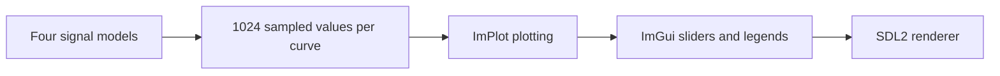

# ImPlot Real-Time Signal Theater

## Scientific showcase: experience and mechanisms

### What the visitor experiences

Turn harmonic interference, wave packets, amplitude modulation and frequency drift into an instrument-like ImPlot oscilloscope with true axes and selectable traces.

### Demonstration sequence

Switch four signal modes, vary amplitude and frequency, toggle both carriers, pause, and inspect the sum or envelope independently.

### Mathematical background

$$\sin(\omega_1t)+\sin(\omega_2t)=2\sin\!\left(\frac{\omega_1+\omega_2}{2}t\right)\cos\!\left(\frac{\omega_1-\omega_2}{2}t\right).$$

The equation describes the relevant mathematical mechanism, rather than independently proving any performance, physical fidelity or runtime success.

### Native pipeline and managed dependencies

The diagram describes data responsibilities. BuildEngine-managed libraries remain versioned package dependencies; a successful visual display cannot replace the declared headless correctness checks.

---

**Test purpose:** Provide an actual interactive scientific plotting application using native ImPlot 1.1 and ImGui 1.93 rendered with SDL2. The former SVG triangle exporter could not draw font atlas glyphs; this version renders real font textures and plot labels in the native window.

The live oscilloscope provides four selectable signal models: interference, modulated waves, wave packets and frequency drift. Time is continuously advanced in the foreground; the 1024 samples per series update on every frame. Frequency, amplitude and simulation speed are controlled by sliders. Carrier A, Carrier B and combined response can be independently shown or hidden. Pause, reset and legend/axis text are part of the fully native UI.

`--verify` runs a non-GUI ImPlot plotting and geometry test using the existing font atlas setup. The interactive version uses SDL2's accelerated renderer with dynamic font atlas textures. The managed packages are ImPlot, ImGui and SDL2. No gnuplot or browser is required.

[Build](build.md) · [License](LICENSE.md) · [SBOM](SBOM.md).

**Verification:** Native BCC64X build and interactive operation confirmed by the operator on 2026-11-18.
