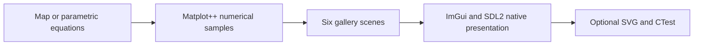

# Matplot++ Mathematical Discovery Gallery

## Scientific showcase: experience and mechanisms

### What the visitor experiences

Six mathematical universes contrast parametrized harmonic curves with iterated nonlinear maps. Matplot++ computes the trajectories; an animated SDL2/ImGui gallery progressively reveals their geometry.

### Demonstration sequence

Visit Lissajous, Clifford, De Jong, Harmonic Bloom, Butterfly and Orbital Resonance; change zoom and progression, optionally export SVGs.

### Mathematical background

$$x_{n+1}=\tfrac12[\sin(1.7y_n)+0.93\cos(1.7x_n)],\quad y_{n+1}=\tfrac12[\sin(-1.8x_n)+0.72\cos(-1.8y_n)].$$

The equation describes the relevant mathematical mechanism, rather than independently proving any performance, physical fidelity or runtime success.

### Native pipeline and managed dependencies

The diagram describes data responsibilities. BuildEngine-managed libraries remain versioned package dependencies; a successful visual display cannot replace the declared headless correctness checks.

---

**Test purpose:** Six mathematically distinct scenes sampled by Matplot++, visualized inside a native ImGui/SDL2 gallery with labeled previews, animated drawing, zoom and optional SVG export.

The native application displays six mathematical scenes: Lissajous Interference, Clifford Attractor, De Jong Attractor, Harmonic Bloom, Butterfly Curves and Orbital Resonance. Matplot++ 1.2.2 supplies 12,000 numerical samples per scene. The application uses native ImGui 1.93 and SDL2 for labeled previews, scene selection and progressively drawn, rotating detail visualizations. The font atlas is rendered as an actual SDL texture; labels are not converted to textless SVG triangles.

Select one of six tiles and choose Explore scene. Pause, restart, adjust speed and zoom, switch to the next or previous scene, or return to the gallery. SVG export is available but not needed for live viewing.

The headless CTest verifies all six numerical scenes without opening a GUI. The separate `--export` mode creates six SVG files for independent presentation in the central BuildEngine Server. These exports are optional and not the main user experience.

See [build instructions](build.md), [license](LICENSE.md) and [SBOM](SBOM.md).

**Verification:** Native BCC64X build and interactive operation confirmed by the operator on 2026-11-18.
