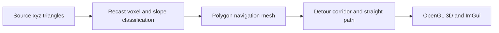

# Navigation Reactor — 3D Detour Expedition

## Showcase key visual and runtime replacement

*Generated concept illustration, not an actual runtime screenshot.* The image depicts the data flow and scientific purpose of this project. Its geometry and display panels are explanatory, not evidence that the application produced those pixels.

**Runtime evidence:** Press **F11** to toggle fullscreen/windowed mode and **F1** for the native About screen where the application's UI supports these shortcuts. The generated illustration can later be replaced by a genuine captured application image in the central `tests/Images` directory; record the replacement's provenance as `runtime-screenshot` and update the manifest's `images.tile` and `images.hero` URLs accordingly.

## Scientific showcase: experience and mechanisms

### What the visitor experiences

Recast builds a real walkable navigation mesh from the very same 3D terrain rendered in the viewer. Detour finds a corridor and path rather than accepting a separately drawn route.

### Demonstration sequence

Rotate source terrain, toggle walkability, polygon and corridor overlays, vary slope and central obstacle. A path must only appear when native Detour finds one.

### Mathematical background

$$\theta=\arccos\!\left(\frac{\mathbf n\cdot (0,1,0)}{\|\mathbf n\|}\right),\qquad \theta\le\theta_{\max}\ \Longrightarrow\ \text{candidate walkable triangle}.$$

The equation describes the relevant mathematical mechanism, rather than independently proving any performance, physical fidelity or runtime success.

### Native pipeline and managed dependencies

The diagram describes data responsibilities. BuildEngine-managed libraries remain versioned package dependencies; a successful visual display cannot replace the declared headless correctness checks.

---

## Actual 3D terrain, not a coloured flat raster

The primary view renders **the very same 81 x 51 source terrain vertex grid and 8,000 triangles** that the native Recast pipeline classifies and rasterizes. Perspective projection, altitude-aware colouring, triangle lighting and optional wireframes make the landscape spatially legible. Terrain heights are not reconstructed from or approximated by the navigation result: the visualization and Recast both consume exactly the same world-coordinate xyz arrays.

Rotate the camera by dragging the main viewport with either mouse button, zoom with the mouse wheel, or use the explicit azimuth, elevation and camera-distance sliders. Disable **3D terrain** to inspect the previous 2D voxel/walkability raster. Toggle **Mesh wireframe** to inspect the actual terrain triangulation.

## Navigation and route

Recast performs walkability classification, rasterization, compact heightfield construction, erosion, region segmentation, contour extraction, polygon/detail mesh construction and serialization into a native Detour navmesh. Detour `findNearestPoly`, `findPath`, and `findStraightPath` produce the waypoints used by the visualizer. The route, start/goal beacons and animated agent are projected through the **same 3D camera** as the source mesh, including the returned Y elevations. A route is never drawn when Detour cannot establish a complete path.

Sliders for agent slope and terrain relief rebuild the Recast/Detour navigation, while the **Central obstacle** checkbox removes triangle areas from navigation and visualizes the exclusion zone. **Animate agent** controls the route traversal indicator. The overlay is a visualization of returned Detour coordinates, not a separately calculated shortest path.

## Capability boundaries

This is perspective 3D rendering through the existing native ImGui/SDL2 geometry path, without a new renderer library or graphics API dependency. It demonstrates geometry and pathfinding, **not** physically-based lighting, shadows, collision simulation, dynamic obstacles, multiple agents, DetourCrowd, DetourTileCache or user-selectable route endpoints. The reference 2D layer remains a separate voxel diagnostic.

## Verification

`navigation-reactor.exe --verify` checks the original Recast slope response, triangle count and rasterization, plus a complete Detour path on a deterministic terrain. It does not inspect pixels or mouse behaviour. Windows BCC64X compilation, screenshot/visual acceptance and real runtime execution are **[not verified]** until performed on the host.

## Dependency decisions

The installed Recast Navigation 1.6.0 package builds separate DLLs, with upstream demo, examples and tests disabled. The showcase links managed Recast/Detour, Mesa OpenGL 26.2.1, GLEW 2.3.1, Dear ImGui 1.93.0 with its **official SDL2/OpenGL3 backend DLL**, and SDL2 2.32.10. The core ImGui library remains independent of the backend and the backend sources are compiled by the ImGui producer, not bundled with or reimplemented by this showcase. No additional rendering framework, physics engine or SDK DLL sweep is added.

## Official backend integration and GPU acceptance

The custom ImGui draw-command adapter has been removed. `OpenGLShowcase.h` is only SDL2/WGL context lifecycle and calls `ImGui_ImplSDL2_InitForOpenGL`, `ImGui_ImplOpenGL3_Init`, `ImGui_ImplSDL2_ProcessEvent`, both official `NewFrame` functions and `ImGui_ImplOpenGL3_RenderDrawData`. These symbols are exported by the extended, managed ImGui backend DLL. `TerrainGL.h` retains the showcase-specific GPU scene renderer for the genuine Recast vertex mesh and native Detour path: custom scene shaders are appropriate here, unlike replacing Dear ImGui's upstream renderer.

The GPU renderer uses a dedicated FBO with depth attachment, GPU vertex buffers and GLSL 330 core shaders. On startup it requests an OpenGL 3.3 core profile, initializes the existing managed GLEW and displays the actual context version. Mesa 26.2.1 is installed in its configured Windows Gallium softpipe profile, so hardware acceleration and frame rate are not asserted. The optional higher OpenGL profiles are not disabled by the code; the 3.3 requirement is the chosen minimum API.

`NavigationReactorMesaOpenGL` invokes `--verify-gl`, requiring a real SDL2/OpenGL context and successful terrain renderer execution, whereas the original CTest covers Recast/Detour without opening a window. Neither is considered PASS until the Windows host reports it. All producer and showcase reports remain **[not verified]** until executed.

## Detour route surface reconstruction (20 November 2026)

Detour `findStraightPath` returns a small set of funnel corners that form an efficient navigation corridor; these are not a dense terrain-following polyline. Drawing them as long, straight 3D segments can create visually floating chords through mountainous relief. The Navigation Reactor now samples each Detour segment at half the Recast heightfield cell size and uses `dtNavMeshQuery::findNearestPoly` on every sample to retrieve a navigable surface coordinate and elevation. Points that cannot be mapped within the horizontal clearance threshold cause an **incomplete route**, never a fabricated visual path. The same surface samples drive the GPU path and animated agent, as well as the raster view.

The headless `--verify` mode now checks for dense route samples and bounded horizontal sample distances, instead of treating any two-point route as an adequate demonstration. Full corridor-topology validation and a richer visible navigation-mesh overlay remain further acceptance steps; neither is claimed by this change. **[not verified]** until native BCC64X execution.

## Native Detour mesh and corridor overlay (20 November 2026)

The showcase now exports triangles from the **actual Detour detail mesh** (`dtMeshTile::detailMeshes`, `detailTris`, `verts`, and `detailVerts`) instead of deriving a visualization from unrelated heightfield geometry. The polygon references returned by `dtNavMeshQuery::findPath` determine corridor membership; each tile's polygon references are matched against that exact result. The Mesa OpenGL GPU overlay can independently display all navigable triangles in translucent teal and the route corridor in translucent orange. The native shaded terrain remains visible underneath both overlays.

Surface samples are no longer projected to arbitrary nearby polygons: every sample is evaluated against the **returned path-corridor polygon references only**, using `dtNavMeshQuery::closestPointOnPoly`. If a point cannot be placed within the horizontal clearance, the route is incomplete. Route and moving agent use that same validated sequence. This establishes geometric corridor membership; more advanced agent-radius clearance and dynamic-obstacle avoidance are not claimed.

The UI includes independent `NavMesh polygons` and `Detour corridor` checkboxes. Both `--verify` and `--verify-gl` include native detail triangle/corridor consistency evidence. GPU test requires a real SDL2/Mesa display context. **[not verified]** until native Windows BCC64X execution.
