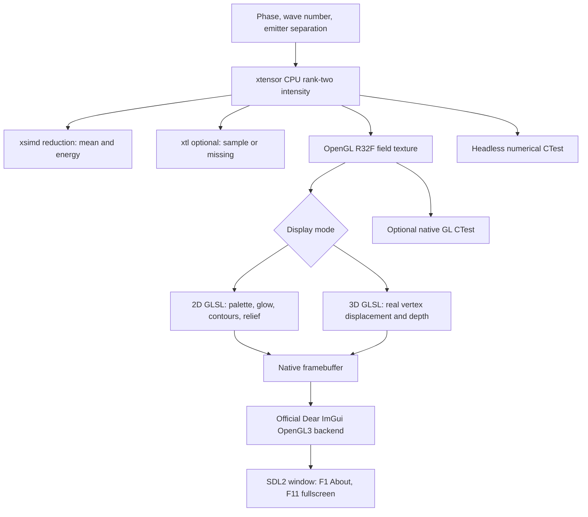
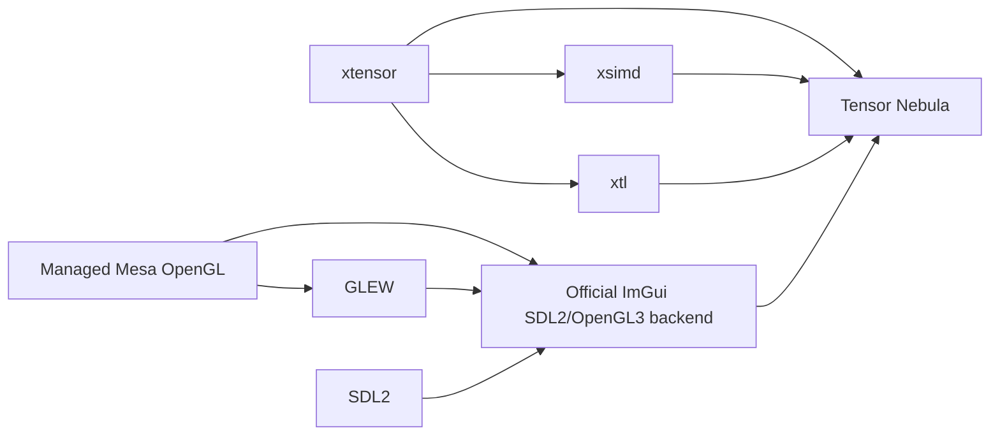

# Tensor Nebula — The Mathematics of Light

[TOC|Contents]

*Original generated concept illustration, not a runtime screenshot.*

## Explore an interference universe

Two luminous circular emitters weave bright and dark interference fringes across a smooth, panoramic field. Add a third source to create intricate symmetry. Change the wave number, separation and relative phase to transform the wave topology. Switch to **3D Wave Landscape** and the actual computed intensity rises into a navigable, depth-tested triangular terrain.

The field is computed by **xtensor 0.27.1** on the CPU and remains the single scientific data source for rendering, metrics and probes. **xsimd 13.2.0** evaluates real vectorized reductions; **xtl 0.8.0** represents measurements that can genuinely be absent. Managed **OpenGL 26.2.1**, **GLEW 2.3.1**, **SDL2 2.32.10** and the official **Dear ImGui 1.93.0** backend handle visualization. No GPU shader secretly substitutes an alternative physical simulation.

## Physics: four mathematical experiences

### Binary stars: coherent two-source interference

For point sources at positions \(\mathbf s_1=(-d/2,0)\) and \(\mathbf s_2=(d/2,0)\), define:

\[
A_1(\mathbf r)=\cos(k\|\mathbf r-\mathbf s_1\|),\quad
A_2(\mathbf r)=\cos(k\|\mathbf r-\mathbf s_2\|+\varphi).
\]

The normalized field is

\[
I_2(\mathbf r)=\frac14(A_1+A_2)^2,\qquad 0\le I_2\le1.
\]

The constructive and destructive fringes arise directly from phase superposition; no texture artwork represents measured physical intensity.

### Trinity: three coherent sources

A third source at \((0,1.4)\) introduces triangular interference topology:

\[
I_3(\mathbf r)=\frac19\left[
\cos(kr_1)+\cos(kr_2+\varphi)+\cos(kr_3-\varphi/2)
\right]^2,\quad r_i=\|\mathbf r-\mathbf s_i\|.
\]

### Standing-wave chamber

A separable stationary pattern gives orthogonal nodal lines:

\[
I_{\mathrm{standing}}(x,y)=\sin^2(kx)\sin^2(ky+\varphi).
\]

### Gaussian pulse

A localized ring field uses the envelope parameter \(\sigma\):

\[
I_{\mathrm{pulse}}(x,y)=
\exp\!\left(-\frac{x^2+y^2}{2\sigma^2}\right)
\cos^2\!\left(k\sqrt{x^2+y^2}-\varphi\right).
\]

These are bounded educational wave models rather than a calibrated radiometric simulation.

## From 3,168 rectangles to a genuine floating-point GPU field

The original renderer displayed **72 × 44** separate SDL rectangles. The new numerical choices are:

| Quality | Tensor resolution | Values |
| --- | --- | ---: |
| Standard | 512 × 288 | 147,456 |
| Detail | 768 × 432 | 331,776 |
| Cinema | 1024 × 576 | 589,824 |

The CPU numerical field is uploaded as a single-channel **GL_R32F** texture. Native OpenGL linear texture filtering smooths the display without pretending that extra samples were computed. Fragments add independently controllable color palettes, exposure, luminous diffusion, intensity contours and gradient-based lighting.

The surface normal used for illuminated relief is approximated by

\[
\mathbf n=\frac{(-\alpha\,\partial_x I,-\alpha\,\partial_y I,1)}
{\sqrt{1+\alpha^2(\partial_xI)^2+\alpha^2(\partial_yI)^2}}.
\]

The **3D Wave Landscape** is not fake perspective. A real indexed OpenGL triangle grid reads the same texture in the vertex shader, displaces mesh vertices and uses a depth buffer. Changing physical parameters recomputes the CPU tensor; changing palettes and camera controls does not alter numerical evidence.

## Four display modes

- **Cinematic Nebula:** flowing colors, luminous diffusion and optional contours
- **Scientific Contours:** emphasized isolines and true individual tensor probes
- **Illuminated Relief:** normal-based surface lighting and exposure controls
- **3D Wave Landscape:** geometric heightfield, orbit camera and depth testing

Color and glow are visual choices, not physical measurements. No GPU speedup or frame-rate claim is made without native profiling.

## Architecture and managed dependencies

| Managed component | Technical role |
| --- | --- |
| [xtensor 0.27.1](/library/xtensor/0.27.1/) | Real numerical field storage |
| [xsimd 13.2.0](/library/xsimd/13.2.0/) | SIMD block reduction and metrics |
| [xtl 0.8.0](/library/xtl/0.8.0/) | Nullable scientific probe |
| [OpenGL 26.2.1](/library/opengl/26.2.1/) | Mesa managed OpenGL context and GPU renderer |
| [GLEW 2.3.1](/library/glew/2.3.1/) | GL 3.3 entry points |
| [ImGui 1.93.0](/library/imgui/1.93.0/) | Official SDL2/OpenGL3 UI backends |
| [SDL2 2.32.10](/library/sdl2/2.32.10/) | Native desktop and input |

## Presentation and interaction

Begin with Binary Stars, cinematic palette and animated phase. Slowly adjust emitter separation. Switch to Trinity, then Scientific Contours, to expose mathematical structure. Use a 3D landscape and orbit camera to explore the same field as actual mesh geometry.

| Input | Action |
| --- | --- |
| **F1** | About, including library renderer and help |
| **F11** | Reversible fullscreen/windowed toggle |
| 2D left drag | Pan |
| 2D wheel | Zoom |
| 2D hover | Real xtensor sample |
| 3D left drag | Orbit the camera |
| 3D wheel | Camera distance |
| Screenshot button | Capture actual rendered framebuffer as BMP |

F1/F11 come from the existing shared OpenGLShowcase adapter, not a new SDL event subsystem.

## Verification and evidence

The default **headless** CPU test executes all four physical modes, checks finite intensity and bounds, tensor dimensions, symmetry, xtl missing samples and xsimd reductions. The separately selectable **GPU** test constructs a real managed Mesa OpenGL context, uploads the tensor, renders a shader pass and a 3D heightfield, then checks GPU status. Desktop testing is explicitly opt-in through TENSOR_NEBULA_ENABLE_GL_CTEST.

A valid library build is not proof of a successful showcase UI. Native GPU support and screenshots require an executed Windows BCC64X application.

## Conceptual desktop application preview

*Generated concept only, not a runtime screenshot. Genuine captures belong under Images/manuals/graphics-tensor-nebula/runtime/.*

**[not verified]** This upgraded application has not yet been compiled or executed with BCC64X.

## Responsiveness: independent numerical computation and GPU presentation

The former implementation performed CPU trigonometric wave calculations, SIMD reductions and OpenGL texture uploads synchronously inside the SDL/ImGui event loop. In particular, software Mesa rendering and large 1024 by 576 tensors could delay sliders, mouse events and window redraw.

The updated design keeps SDL2/ImGui as the sole owner of the GL context. A dedicated C++23 std::jthread computes wave tensors using genuine oneTBB 2023.2.0 parallel_for over independent rows, inside a bounded task_arena to leave cores for the UI. Rapid changes replace pending requests rather than growing a work queue. Every completed CPU tensor and its exact parameters cross the worker/UI boundary as a shared immutable snapshot; no expensive calculation, GL upload or draw runs under the short ownership mutex.

A completed tensor may be displayed even if a newer phase has been requested; this prevents continual phase animation from starving the display. The R32F texture is reallocated only for changed dimensions, and normal updates use glTexSubImage2D. The Mesa framebuffer is updated at most approximately 25 times per second, while the ImGui input loop continues between draws.

### Scheduling architecture

```mermaid
flowchart LR
   UI[SDL2 and ImGui events] --> Q[Latest pending settings]
   Q --> W[std::jthread numerical worker]
   W --> T[Bounded oneTBB task_arena]
   T --> P[parallel_for independent xtensor rows]
   P --> X[xtensor intensity and xsimd metrics]
   X --> S[Immutable completed snapshot]
   S -->|short ownership exchange| U[UI OpenGL thread]
   U --> G[R32F GPU texture upload]
   G --> F[GPU framebuffer at up to 25 Hz]
   F --> I[ImGui view and interactive controls]
```

### User-adjustable performance

The Motion and Evidence panel exposes Compute frames / second (4 to 40) and GPU render scale (0.4 to 1.0). The former controls numerical sampling frequency, while the latter reduces pixel workload without changing the physical tensor's numerical resolution. For software Mesa, begin with 512 by 288 tensor values, 16 to 24 compute frames per second and a GPU scale of 0.6 to 0.75.

Headless CTest also stresses latest-request coalescing by submitting 24 rapid changes and verifying the final field arrives. Native BCC64X execution and measured latency remain **[not verified]**.

OpenMP is intentionally not nested with oneTBB in the same computation: a second scheduler would introduce oversubscription and make responsiveness harder to reason about. This makes no general performance claim comparing oneTBB with LLVM OpenMP.
