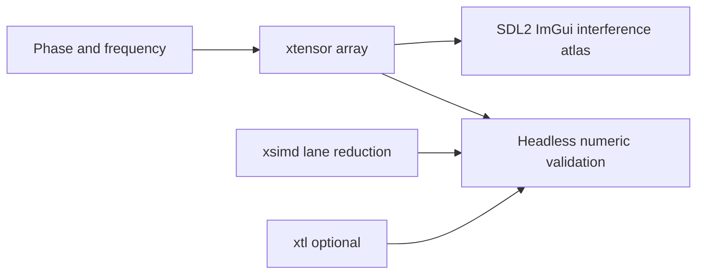

# Tensor Nebula — Mathematics of Light

*Original concept artwork, not a native screenshot.*

## Experience

Two luminous emitters illuminate a wave observatory. Adjust phase and spatial frequency to alter constructive and destructive interference across a 72 × 44 live intensity tensor. Actual installed xtensor values feed the native heatmap.

## Mathematical model

$$A_i(\mathbf r)=\cos(k\|\mathbf r-\mathbf s_i\|+\varphi_i),\quad I(\mathbf r)=\frac14(A_1+A_2)^2.$$

The positions are \(\mathbf s_1=(-1.35,0)\), \(\mathbf s_2=(1.35,0)\). The superposition law explains the bright and dark fringes.

## Architecture

## Acceptance

The standalone `--verify` checks tensor dimensions, finite intensity bounds, true xsimd reduction and xtl optional semantics. F11 toggles fullscreen and F1 displays About using the existing native window adapter.

## UI concept

*Not a screenshot. Replace after BCC64X visual verification.*

**[not verified]** Native compile, CTest and interactive rendering are pending.