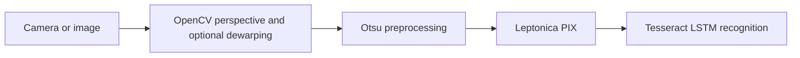

# Tesseract OCR Studio

## Showcase key visual and runtime replacement

*Generated concept illustration, not an actual runtime screenshot.* The image depicts the data flow and scientific purpose of this project. Its geometry and display panels are explanatory, not evidence that the application produced those pixels.

**Runtime evidence:** Press **F11** to toggle fullscreen/windowed mode and **F1** for the native About screen where the application's UI supports these shortcuts. The generated illustration can later be replaced by a genuine captured application image in the central `tests/Images` directory; record the replacement's provenance as `runtime-screenshot` and update the manifest's `images.tile` and `images.hero` URLs accordingly.

## Scientific showcase: experience and mechanisms

### What the visitor experiences

Turn a photographed page into recognized text. OpenCV handles crop, perspective, thresholding and optional curved-page remap; Leptonica supplies real PIX objects; Tesseract performs native LSTM inference.

### Demonstration sequence

Choose a camera or image, view source/corrected images, adjust the curved-book transform only when needed, compare OCR UTF-8 result and confidence.

### Mathematical background

$$t^*=\arg\max_t \omega_0(t)\omega_1(t)\bigl(\mu_0(t)-\mu_1(t)\bigr)^2.$$

The equation describes the relevant mathematical mechanism, rather than independently proving any performance, physical fidelity or runtime success.

### Native pipeline and managed dependencies

The diagram describes data responsibilities. BuildEngine-managed libraries remain versioned package dependencies; a successful visual display cannot replace the declared headless correctness checks.

---

## Experience

A native OCR workbench that renders a synthetic English document with OpenCV or accepts an existing PNG/JPEG. The operator can enable/disable **Otsu thresholding**, select **single-line or automatic page segmentation**, and inspect the original image, processed grayscale pixels, recognized UTF-8 text, confidence and recognition time.

## Architecture

- **OpenCV 5.1** provides synthetic input rendering, grayscale conversion, thresholding and optional external image loading.
- **Leptonica 1.87.0** owns the actual 8-bit `PIX` image supplied to Tesseract.
- **Tesseract 5.5.4** performs native LSTM recognition with the **managed** `share/tessdata/eng.traineddata` model. No model is downloaded by the showcase.
- **SDL2 and Dear ImGui** provide native controls and visual diagnostics.

The model path comes from the exact installed active Tesseract package. A missing model is an explicit error; it is not silently replaced by an SDK or system-wide OCR installation.

## Verification

`--verify` renders `OCR TEST 4711`, preprocesses it using OpenCV, transfers pixels through Leptonica, and requires Tesseract to recognize the exact string and return a valid confidence. A failing OCR result is an explicit failing test, never reported as success.

**[not verified]** Native Windows BCC64X compilation and exact OCR output are pending.

## Processing and recognition stages

The input comes from OpenCV's deterministic text renderer or from a user-selected PNG/JPEG image. OpenCV first normalizes the image to grayscale, then optionally performs Otsu thresholding. These are distinct visual stages and the interface displays the original image separately from the exact processed pixels. This makes it possible to inspect the effects of threshold selection instead of judging recognition quality from the OCR text alone.

The resulting eight-bit pixel values are copied into a Leptonica `PIX` image owned by a scoped RAII wrapper. Tesseract's `TessBaseAPI` is initialized with the explicit `share/tessdata` directory of the **active installed** package and the English LSTM model. The application selects `PSM_SINGLE_LINE` for a known one-line sample or `PSM_AUTO` for general document layout and invokes Tesseract's native `Recognize` and `GetUTF8Text` APIs. The returned text and confidence originate from Tesseract; no expected value is substituted on recognition failure.

The deterministic headless test verifies an exact recognized text instead of merely checking that Tesseract can load the model. Real-world documents may require different page segmentation, layout detection, camera correction and language-specific traineddata. Those capabilities are not disabled by this showcase; its currently installed model provides English recognition only.

For complete Release/Debug configuration, one-line commands, CTest, installation and troubleshooting, see [build.md](build.md).

## Selectable webcam and deliberate frame recognition (20 November 2026)

The application now provides a named **DirectShow camera combobox**, **REFRESH CAMERAS**, **CONNECT SELECTED**, **CONNECT BY INDEX**, **DISCONNECT**, **FREEZE FRAME**, **RESUME LIVE**, and **RECOGNIZE FRAME**. The camera list uses the shared Windows COM DirectShow enumeration component in `graphics/common/CameraDevices.h`. It does not open any cameras merely to discover them. Consequently, a registered but currently unavailable device can remain visible. The manual camera index field is available for devices omitted or reordered by Windows. The actual availability of the user's camera hardware is determined only when opening a selected device.

Live frames are acquired through the installed **OpenCV 5.1 `videoio`** component using `cv::VideoCapture::open(index, cv::CAP_DSHOW)`. A shared `CameraFrameView` wraps an SDL2 streaming texture to display a real camera image through the existing ImGui/SDL2 renderer. This avoids rendering each video pixel as individual ImGui geometry. The current camera selection, capture status, acquired-frame count and driver failures remain visible.

**OCR is an explicit operation, not a continuous per-frame task.** Pressing **FREEZE FRAME** creates an immutable copy of the latest camera image and pauses capture. **RECOGNIZE FRAME** sends either that frozen image or the current live frame into the existing OpenCV grayscale/Otsu → Leptonica PIX → Tesseract English LSTM pipeline. The recognized text, confidence and processing duration remain available while the camera continues to display new frames. Pressing **RESUME LIVE** resumes capture without discarding the last successful OCR result. Changing the camera releases the previous device; the synthetic-document and imported-image workflows remain independent and available.

For diagnostic purposes, `--list-cameras` prints the registered DirectShow device indices, friendly names and paths without opening any capture device. The original `--verify` is still **camera-independent** and asserts actual recognized text, confidence and measurable spacing in the synthetic source image. The webcam feature does not reduce that verification coverage.

**[not verified]** The live DirectShow source, GUI rendering and Windows device order have not yet been executed on the BCC64X host.

## Multiparagraph document capture, geometry and language selection (20 November 2026)

An actual camera capture of a German book back-cover returned **0% confidence and empty text** when the application used its original single-line OCR configuration on the complete camera frame. The image showed several small paragraphs on a perspective-distorted document, plus a barcode, desk and other nontext objects. This is not a meaningful input for `PSM_SINGLE_LINE`; moreover the first active Tesseract 5.5.4 package provided only `eng.traineddata`. The screenshot's severely downsampled grayscale previews were **visual diagnostics only**, but they prevented a useful inspection of the source OCR region.

The interactive camera workflow now defaults to **Automatic page segmentation (PSM 3)**, with explicit alternatives for a **single text block (PSM 6)** or **single line (PSM 7)**. No OCR output is normalized to conceal missing spaces or wrong characters. Camera capture can request device default, 1280×720, 1920×1080 or 3840×2160; the application reports the **actual frame dimensions** supplied by DirectShow, because drivers may reject or substitute a requested capture mode. Pixel enlargement is optional and performed only on the selected source region, with the explicit limitation that interpolation cannot recreate missing optical detail.

Document selection uses a dedicated native OpenCV component, `DocumentRegion.h`. **Full frame** passes through the original pixels. **Manual text rectangle** crops a configurable normalized ROI whose boundaries are drawn as a yellow overlay on the live SDL camera image. **Detect document quadrilateral** uses OpenCV Gaussian blur, Canny edges, contours, polygon approximation, convexity/area tests and the genuine `getPerspectiveTransform`/`warpPerspective` functions to rectify a detected four-corner document from the *original full-resolution camera frame*. If no plausible quadrilateral exists, the source remains the full frame and the UI reports the absence instead of claiming an invented page. Manual cropping is especially important when the camera sees a book cover or label with several nested rectangles and the desired region cannot be inferred unambiguously.

The old 120-pixel-high grayscale debug strips, formerly rendered from a reduced OpenCV raster, have been replaced with native SDL2 texture views of the selected document and the actual OpenCV grayscale/Otsu preprocessing. Both preserve image aspect ratio and provide up to 450 vertical pixels of diagnostic display. Recognized UTF-8 is presented in a **scrollable, copyable multiline result field**, not only a single short label. The last recognition remains visible while the camera is running or frozen. Only an explicit `RECOGNIZE FRAME` invokes the expensive Tesseract LSTM engine.

**Language is not a presentation setting**: OCR needs matching traineddata. The UI now offers English `eng`, German `deu` and mixed `deu+eng`. All models are loaded exclusively from the active managed Tesseract `share/tessdata` directory. If the German file has not yet been installed, the UI displays that limitation and selecting it produces a clear error; the application never downloads a model at runtime. The BuildEngine-Admin Tesseract 5.5.4 producer now declares the official German fast model from the same pinned `tessdata_fast` revision as its existing English model. This package must be rebuilt and reinstalled before German OCR becomes available.

The camera-independent `--verify` continues to require exact text output and now also tests manual ROI dimensions and native OpenCV quadrilateral extraction. The headless test does not claim any specific German camera text is recognized without checking it. **[not verified]** New C++ sources, page detection, model provisioning and GUI require native Windows BCC64X tests.

## Curved book-page dewarping with native OpenCV remap (21 November 2026)

Real book pages frequently curve toward the gutter. Four-corner `warpPerspective` only corrects a planar projective transformation; it **cannot** straighten text baselines on a genuinely curved sheet. OCR Studio now includes a separate, switchable **Straighten curved book page (OpenCV remap)** stage. It runs **after** camera-region selection/perspective rectification and **before** Tesseract grayscale/Otsu processing. It operates on full-resolution document pixels, never on the displayed reduced preview.

The initial operator-guided model is a *signed vertical baseline bow* `offset(x) = curvature * height * sin(pi * x / (width - 1))`. The UI exposes a signed `[-0.18, +0.18]` page-height slider. `DewarpBookPage` constructs genuine per-pixel CV_32FC1 X/Y maps and runs `cv::remap` with bilinear resampling and replicate border pixels. The source camera frame remains unchanged; the selected/straightened image and actual Tesseract preprocessing preview show the processed raster.

The camera-independent `--verify` now builds a synthetic grayscale image with a known curved baseline, runs real OpenCV remapping and asserts that a baseline displaced by at least 25 pixels is reduced to at most 4 pixels. It retains the original exact OCR string assertion, confidence, word-spacing, manual ROI and perspective geometry tests. New capabilities have **not** been declared verified until the native BCC64X CTest succeeds.

**Scope limitation:** This is an intentionally transparent, adjustable **one-dimensional line-straightening model**, not a claim of automatic physical 3D page reconstruction. A severely folded page, strong perspective combined with varying depth, a page crossing the gutter, or locally asymmetric text distortion needs a richer surface model estimated from page contours/text baselines or multiple views. This method can improve readability and thus OCR, but improvements on real photographed books must be measured against original OCR output and confidence. Do not apply the adjustment to a flat page merely because an automatic detector finds a quadrilateral.

### Preview of the desktop application (concept)

*Generated application-window mockup, not a screenshot.* The panels, colors, graphs and displayed indicators illustrate a possible future interface and are **not** actual runtime measurements. Replace this image with a real capture after the native BCC64X application is built and visually accepted. Keep the original concept in `Images/manuals/graphics-tesseract-ocr-studio/concept/` and place verified captures under `Images/manuals/graphics-tesseract-ocr-studio/runtime/`.

