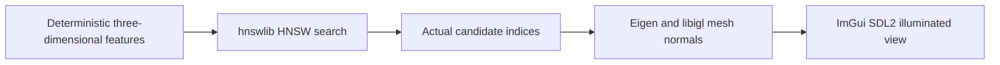

# Vector Galaxy — The Shape of Similarity

## Showcase in action: science and architecture

### Why this example matters

Vector similarity becomes a navigable 851-star nebula: the actual HNSW search highlights neighbor indices while libigl and Eigen calculate mesh normals for lighting.

### The demonstration

Move the query in three axes, vary the neighbor count, inspect which stars HNSW returns and zoom through the normal-lit surface.

### Mathematical and technical foundations

$$d(\mathbf q,\mathbf v_i)=\sqrt{\sum_{j=1}^{3}(q_j-v_{ij})^2}.$$

The equation provides context for the implemented numerical or rendering path. It is not evidence of runtime success or a claim that a simplified model represents every possible physical case.

### Native data flow and dependencies

All package/library identities remain those declared in the existing showcase manifest. Existing build and verification instructions below are retained.

---

## The invitation

What does **similarity** look like when an index of hundreds of objects becomes a living universe? Vector Galaxy turns feature-space retrieval into a luminous, explorable topographic nebula. Search vectors move through three dimensions; cyan rings reveal the neighbours actually returned by the managed hnswlib index. The geometry is not a painted backdrop: a triangulated 851-vertex heightfield is analysed with libigl and Eigen, and its normals influence the light of the mesh.

## Real computation

Each of 851 points has a deterministic three-dimensional feature vector. `hnswlib::HierarchicalNSW<float>` is populated once and returns `k` closest candidates for a user-controlled query. Separate Eigen vertex and face matrices are passed to `igl::per_vertex_normals`. The viewer projects the mesh, draws its edges, applies a normal-driven color, and highlights precisely the returned HNSW indices.

This is an educational, deterministic, small-scale ANN demonstration, not a claim that a given HNSW result is an exact globally optimal nearest neighbour or a production artwork embedding model.

## Experience and controls

Use **Search position X/Y/Z** to explore the indexed field, **Nearest stars** to control neighbour count, and **Telescope zoom** to navigate the image. Freeze or resume orbital motion and reset the experiment at any time. Hover descriptions explain which library owns which computation; the renderer does not substitute its own nearest-neighbour algorithm.

The application is based on the existing installed SDL2 + Dear ImGui renderer. It consumes the installed hnswlib, libigl, and Eigen interfaces. The scene contains no downloaded images or untracked external dependencies.

## Verification

Run `vector-galaxy.exe --verify` or the `VectorGalaxyAlgorithm` CTest to check index return cardinality and finite mesh normals. The GUI is a separate, interactive native Windows application. **[not verified]** Native BCC64X compilation and visual acceptance remain pending.
