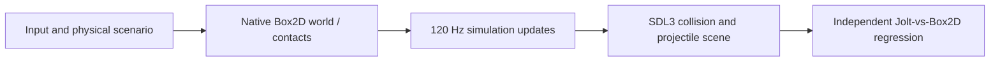
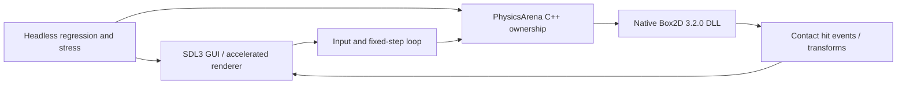

# Neon Physics Arena: integration architecture

## Showcase in action: science and architecture

### Why this example matters

A physics engine should make observable predictions rather than merely drawing falling shapes. The native SDL3/Box2D arena generates genuine collisions, projectile impulses and events. A separate Jolt/Box2D differential test compares independent 3D and 2D engines without falsely demanding identical numerical trajectories.

### The demonstration

Launch projectiles and switch gravity in the neon arena; run the headless stress case twice with seeded inputs; run the separate Jolt-vs-Box2D fixed-step duel and inspect each solver's repeatability.

### Mathematical and technical foundations

$$\mathbf v_{n+1}=\mathbf v_n+\mathbf a\Delta t,\qquad \mathbf x_{n+1}=\mathbf x_n+\mathbf v_{n+1}\Delta t,\quad \Delta t=\frac1{120}\,\mathrm s.$$

The equation provides context for the implemented numerical or rendering path. It is not evidence of runtime success or a claim that a simplified model represents every possible physical case.

### Native data flow and dependencies

All package/library identities remain those declared in the existing showcase manifest. Existing build and verification instructions below are retained.

---

**Test purpose:** Interactive SDL3 and Box2D collisions, projectiles and gravity changes with repeatable physics stress tests.

## Purpose

Show a visibly engaging, genuinely interactive example suitable for young C++ developers while acting as a meaningful *cross-library* BuildEngine consumer test. It deliberately goes beyond the minimal SDL3 and Box2D library smoke tests.

## Component architecture

`PhysicsArena` is an application-level RAII owner, not a replacement API for Box2D. It uses Box2D 3 directly for dynamic and static rigid bodies, circles, colliders, projectile impulses, contact events, gravity reversal and world destruction. The graphical executable uses SDL3 3 directly for a native window, accelerated triangles, lines, debug text, input, logical scaling, VSync and BMP framebuffer capture.

The application runs Box2D with one worker at 120 Hz for reproducibility; the renderer is independent of physics iteration frequency. Maximum accumulated physics catch-up is bounded to six steps per rendered frame. Physics events are copied before the next Box2D world step, because the upstream event storage is transient. Visual sparks are bounded and do not influence the Box2D simulation.

## Strict BuildEngine architecture

Both producer packages must have already been built and installed. Active package versions are selected through `adecc_package_current_root`, and matching imported native shared targets are required. The test never downloads third-party sources, changes upstream packages or uses fallback compilers. Each build configuration uses its own CMake/Ninja directory and staged recursive PE import closure. No bundled static SDL3 or Box2D replacement is allowed.

## Test scenarios

The headless executable makes the same series of projectile and radial-impulse inputs in two fresh worlds, advancing 480 or 2,400 exactly fixed time steps. It compares quantized world state, contact counts, score and body count. It also confirms SDL3 can initialize without a graphics desktop. Native timings are informational, not pass thresholds.

See [build.md](build.md), [LICENSE.md](LICENSE.md), [SBOM.md](SBOM.md).

**[not verified]** All build, test, and screenshot claims above describe intended implementation behaviour; real BCC64X execution is pending.

## Applications and interactive operation

**`neon-physics-arena.exe`** — Interactive SDL3/Box2D physics show with collisions and projectiles.

**`neon-physics-verify.exe`** — Headless deterministic and stress test.

Left click launches a projectile; right click applies a radial impulse; G toggles gravity direction; Space pauses/resumes; R resets the deterministic scene; P captures the current SDL framebuffer as neon-physics-arena.bmp; Esc exits. Headless verification uses a separate executable.

## Differential Physics Challenge: Jolt versus Box2D

A third independently runnable program `neon-physics-duel.exe` creates two equivalent vertical drop experiments through separate, installed native DLL APIs. Jolt Physics 5.7.0 provides a 3D sphere, box floor, broadphase layer interfaces, native allocator and single-threaded job system. Box2D 3.2.0 provides the corresponding 2D circle, floor and fixed-step solver. Both are simulated for 720 steps at 120 Hz. Each engine is also run twice from a new world to test its own repeatability.

A correct result requires finite positions, falling bodies, stable floor contacts, and repeated matching per-engine sampled heights. The comparison reports per-second trajectories and separate timings without pretending that unrelated 2D and 3D solver implementations should generate identical numerical values. There is no dependency on the interactive SDL3 renderer for this additional CTest. Library builds are operator-confirmed successful, but the new differential application itself remains **[not verified]** until a native Windows run.
