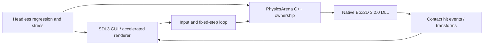

# Neon Physics Arena: integration architecture

## Purpose

Show a visibly engaging, genuinely interactive example suitable for young C++ developers while acting as a meaningful *cross-library* BuildEngine consumer test. It deliberately goes beyond the minimal SDL3 and Box2D library smoke tests.

## Component architecture

`PhysicsArena` is an application-level RAII owner, not a replacement API for Box2D. It uses Box2D 3 directly for dynamic and static rigid bodies, circles, colliders, projectile impulses, contact events, gravity reversal and world destruction. The graphical executable uses SDL3 3 directly for a native window, accelerated triangles, lines, debug text, input, logical scaling, VSync and BMP framebuffer capture.

The application runs Box2D with one worker at 120 Hz for reproducibility; the renderer is independent of physics iteration frequency. Maximum accumulated physics catch-up is bounded to six steps per rendered frame. Physics events are copied before the next Box2D world step, because the upstream event storage is transient. Visual sparks are bounded and do not influence the Box2D simulation.

## Strict BuildEngine architecture

Both producer packages must have already been built and installed. Active package versions are selected through `adecc_package_current_root`, and matching imported native shared targets are required. The test never downloads third-party sources, changes upstream packages or uses fallback compilers. Each build configuration uses its own CMake/Ninja directory and staged recursive PE import closure. No bundled static SDL3 or Box2D replacement is allowed.

## Test scenarios

The headless executable makes the same series of projectile and radial-impulse inputs in two fresh worlds, advancing 480 or 2,400 exactly fixed time steps. It compares quantized world state, contact counts, score and body count. It also confirms SDL3 can initialize without a graphics desktop. Native timings are informational, not pass thresholds.

See [build.md](build.md), [LICENSE.md](LICENSE.md), [SBOM.md](SBOM.md).

**[not verified]** All build, test, and screenshot claims above describe intended implementation behaviour; real BCC64X execution is pending.
