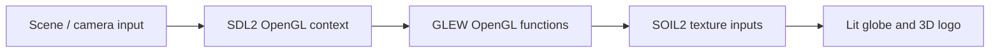

# OpenGL Earth

## Showcase in action: science and architecture

### Why this example matters

Observe the same geometric world under changing viewpoint and illumination: a rotating textured globe, day/night lighting, animated stars and a separate 3D logo. Actual OpenGL textures and transforms provide the effects, not prerendered screenshots.

### The demonstration

Choose Earth Day, Earth Night and Logo. Orbit the camera, change the spotlight and zoom. Watch why a normal-facing surface is bright while the night-facing side becomes dark.

### Mathematical and technical foundations

$$I_{\rm diffuse}=k_d I_L\max(0,\widehat{\mathbf n}\cdot\widehat{\mathbf l}).$$

The equation provides context for the implemented numerical or rendering path. It is not evidence of runtime success or a claim that a simplified model represents every possible physical case.

### Native data flow and dependencies

All package/library identities remain those declared in the existing showcase manifest. Existing build and verification instructions below are retained.

---

**Test purpose:** A textured rotating globe, star field and 3D logo demonstrate managed SDL2/OpenGL rendering.

This independent BuildEngine-Tests project exercises **SDL2, GLEW, SOIL2, OpenGL** with native BCC64X/C++23 consumer code. Its source and its runtime dependency closure are defined by this directory's CMake/IDE configuration and the BuildEngine package catalog.

**Programs:** OpenGLSDL2EarthDemo.

See [build.md](build.md), [LICENSE.md](LICENSE.md), [SBOM.md](SBOM.md) and the generated machine-readable CycloneDX declaration for each program. This page is test documentation, not a statement of verified production suitability.

## Applications and interactive operation

**`OpenGLSDL2EarthDemo.exe`** — Native interactive SDL2/OpenGL 3D logo and day/night Earth.

Use on-screen scene buttons for Logo, Earth Day, Earth Night. Logo mode: Left/Right and Up/Down orbit the camera, Home/End adjust spotlight azimuth, PageUp/PageDown change spotlight elevation, +/- or wheel changes camera distance. Earth mode: arrows move the light, Home/End pan the camera, +/- or wheel adjusts distance. Esc exits.
