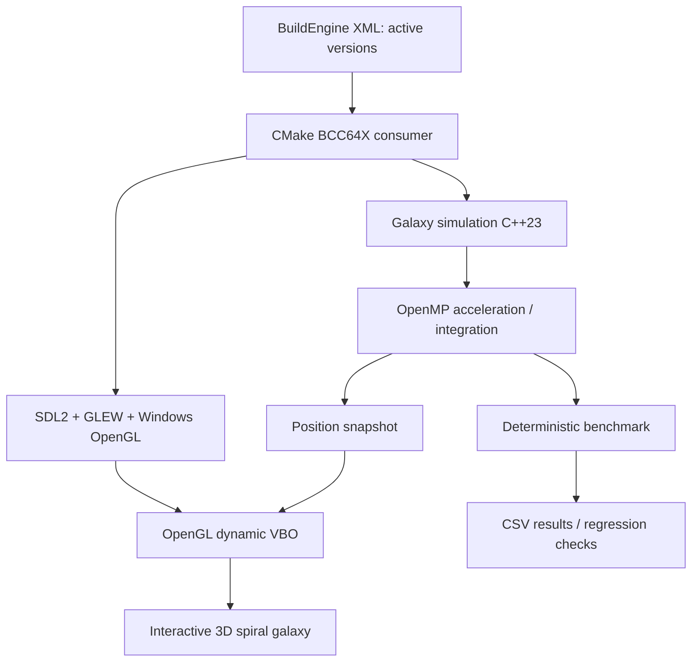
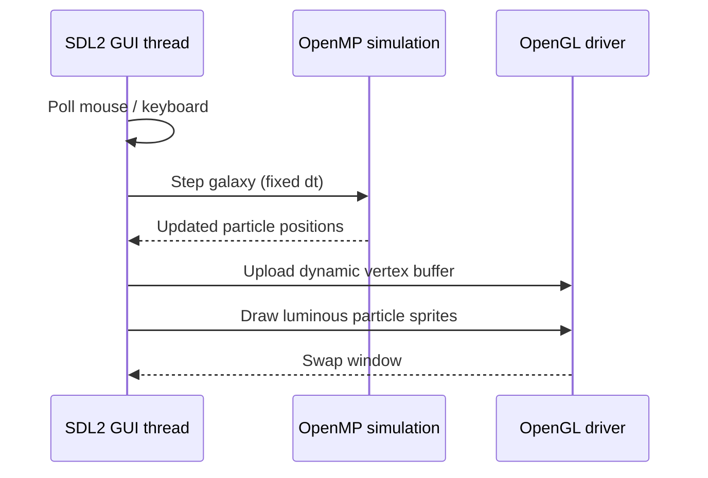
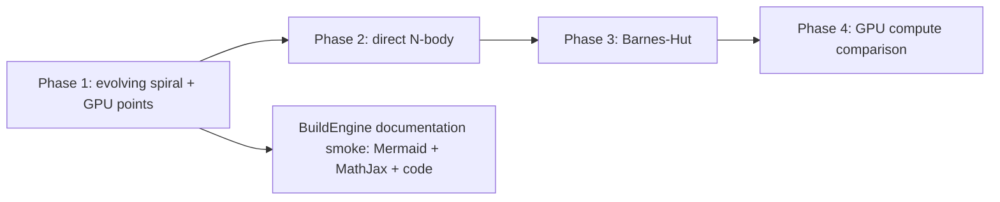

# OpenMP Galaxy — Architecture, mathematics and BuildEngine integration

> **Status:** Phase 1 implementation. A dynamic, visually rich **spiral-galaxy model**, not yet a self-gravitating N-body solver. Performance and numerical results must be verified on BCC64X.  
> **Platform:** C++23, native BCC64X/Clang, LLVM OpenMP shared runtime, SDL2, GLEW, hardware OpenGL 3.3.

## 1. Project goals

1. Render a three-dimensional stellar disk with a luminous central bulge, spiral structure, depth, and an interactive orbit camera.
2. Advance the positions of stars with an actual, reproducible CPU simulation, parallelized with OpenMP.
3. Compare **serial**, **static**, **dynamic**, and **guided** execution over exactly the same initial state, fixed time step and body count.
4. Measure simulation cost **separately** from OpenGL frame rendering and presentation.
5. Use installed **shared** third-party libraries and the BuildEngine XML's active package versions; never copy a Mesa `opengl32.dll` into the application.
6. Make this Markdown document an integration specimen for **Mermaid**, **MathJax**, GitHub-flavored Markdown tables and **syntax highlighting**.

The initial scene uses a **prescribed, spatially varying gravitational potential**. Each particle evolves over time. **It is not direct gravitational interaction between every star.** The distinction is intentional and visible in both documentation and benchmark results. Phase 2 can introduce direct N-body and Barnes–Hut approximations.

## 2. Runtime architecture



**Thread ownership:** SDL and OpenGL calls execute only on the viewer's GUI thread. OpenMP computes the next CPU state, then the main thread uploads a compact position/color buffer. There is no OpenGL call inside an OpenMP parallel region.

## 3. Mathematical model

### 3.1 State vector and units

A star is represented by its position and velocity:

$$
\mathbf{s}_i(t) = (\mathbf{x}_i(t),\mathbf{v}_i(t)),
\qquad \mathbf{x}_i, \mathbf{v}_i \in \mathbb{R}^3.
$$

We use **dimensionless simulation units**, not kilograms, parsecs or physical seconds. Their values are deliberately tuned for a visible, stable educational spiral galaxy. Color and brightness are rendering attributes, not stellar spectroscopy.

### 3.2 Softened external galactic potential

The initial version uses a softened central potential:

$$
\Phi(\mathbf{x}) = -\frac{\mu}{\sqrt{\lVert\mathbf{x}\rVert^2+\varepsilon^2}}.
$$

The corresponding acceleration is the negative gradient:

$$
\mathbf{a}(\mathbf{x})
= -\nabla\Phi
= -\mu\frac{\mathbf{x}}
{(\lVert\mathbf{x}\rVert^2+\varepsilon^2)^{3/2}}.
$$

Here \(\mu>0\) sets the potential strength, and \(\varepsilon>0\) prevents a singularity at the origin. This is a prescribed field, **not an N-body sum**.

For near-circular initialization in the mid-plane, the approximate circular speed at radius \(r\) is:

$$
v_c(r)^2
= r\,\frac{d\Phi}{dr}
= \frac{\mu r^2}{(r^2+\varepsilon^2)^{3/2}},
\qquad
v_c(r) = \sqrt{\frac{\mu r^2}{(r^2+\varepsilon^2)^{3/2}}}.
$$

A small deterministic radial/vertical dispersion adds thickness and visible evolving substructure. The initial spiral-arm distribution is a *sampling technique*, not a self-consistent density-wave solution.

### 3.3 Symplectic integration

The first release uses **kick–drift symplectic Euler**, with fixed simulation step \(\Delta t\):

$$
\begin{aligned}
\mathbf{v}_{n+1} &= \mathbf{v}_{n}+\Delta t\,\mathbf{a}(\mathbf{x}_n),\\
\mathbf{x}_{n+1} &= \mathbf{x}_{n}+\Delta t\,\mathbf{v}_{n+1}.
\end{aligned}
$$

This is first-order accurate in time. Unlike forward Euler, it is symplectic for separable Hamiltonians, so long-term orbital energy behavior is generally better. Fixed steps decouple the simulation's reproducibility from graphics FPS. A second-phase improvement is **velocity Verlet / leapfrog**:

$$
\begin{aligned}
\mathbf{v}_{n+1/2} &= \mathbf{v}_n + \tfrac{\Delta t}{2}\mathbf{a}(\mathbf{x}_n),\\
\mathbf{x}_{n+1} &= \mathbf{x}_n + \Delta t\,\mathbf{v}_{n+1/2},\\
\mathbf{v}_{n+1} &= \mathbf{v}_{n+1/2} + \tfrac{\Delta t}{2}\mathbf{a}(\mathbf{x}_{n+1}).
\end{aligned}
$$

### 3.4 Phase 2 — self-gravitating N-body

For a true N-body galaxy, the acceleration on body \(i\) is:

$$
\mathbf{a}_i =
G\sum_{j\ne i}m_j\,
\frac{\mathbf{x}_j-\mathbf{x}_i}
{(\lVert\mathbf{x}_j-\mathbf{x}_i\rVert^2+\varepsilon^2)^{3/2}}.
$$

The direct method costs \(O(N^2)\) per step and provides an excellent OpenMP benchmark at modest \(N\). Larger populations require an approximation such as **Barnes–Hut**, typically \(O(N\log N)\) with accuracy governed by its opening angle. These algorithms are **not implemented in Phase 1**.

## 4. Parallel execution

The first simulation is embarrassingly parallel, since each body's acceleration depends only on its own position and the external potential:

```cpp
#pragma omp parallel for schedule(runtime)
for (int i = 0; i < bodyCount; ++i) {
   IntegrateOneBody(bodies[i], deltaTime);
}
```

The application selects `static`, `dynamic` or `guided` via `omp_set_schedule()`. For this uniformly expensive step, `static` will usually be the best baseline; `dynamic` and `guided` primarily illustrate scheduling overhead. **A measured speedup is not guaranteed.** Preserve results across schedules by giving each thread independent indices and not using shared random generators during integration.

The initializer uses a fixed-seed integer hash, making the same initial state independent of thread counts. Benchmarks compare positions and velocities, not only a visual checksum.

## 5. Rendering and user interaction

OpenGL draws each star as a programmable point sprite backed by a VBO. The vertex shader computes orbit-camera projection; the fragment shader produces a soft, luminous radial falloff. Additive blending creates the appearance of a glowing cluster. The initial pipeline is **OpenGL 3.3 Core**, not fixed-function OpenGL and not Skia.



**Controls:** drag left mouse button to orbit, mouse wheel to zoom, Space to pause, `1` serial, `2` static, `3` dynamic, `4` guided, `+`/`-` thread count, `R` reset. The first version shows body count, simulation milliseconds and selected scheduling in the window title.

On systems with Intel and NVIDIA GPUs, the application exports an NVIDIA Optimus performance preference, but the installed Windows driver ultimately selects the adapter. The render backend **must never stage Mesa's local `opengl32.dll`**, which previously caused CPU `softpipe` rendering in the OpenGL Earth demo.

## 6. Performance and validation

The benchmark records:
- serial and parallel step time (simulation only),
- body count, fixed time step, number of simulation steps, number of OpenMP threads,
- position/velocity error against the serial reference,
- total kinetic energy and potential energy as diagnostic quantities.

Speedup is:

$$
S_p = \frac{T_1}{T_p},
\qquad E_p = \frac{S_p}{p}.
$$

A sample output format (not a measured result):

```text
mode,threads,bodies,steps,simulation_ms,speedup,max_position_error
serial,1,20000,100,...,1.0,0
static,8,20000,100,...,...,0
dynamic,8,20000,100,...,...,0
guided,8,20000,100,...,...,0
```

**Acceptance criteria:** valid BCC64X Release build; linked DLL runtime `libomp.dll`; benchmark exit 0 and matching deterministic state; GUI window with actual OpenGL hardware renderer; interactive 3D orbit and continuously changing particle positions; installation directly in `build/test/openmp-galaxy/Release`.

## 7. BuildEngine constraints

- Versions resolved by `adecc_package_current_root()` from `admin/build-libraries.xml`.
- `llvm-openmp` imported through `libomp.lib` and deployed as **`libomp.dll`**.
- SDL2 and GLEW from native BuildEngine DLL packages.
- Windows system `opengl32.dll` via driver, never local Mesa.
- Standalone benchmarks and the GUI share the same simulation object code (no static third-party archive).
- Generated executables and staged DLLs reside directly in the chosen `Release` folder; no PowerShell bootstrap, ad-hoc DLL copying, or PATH dependency.

## 8. Planned iterations



Possible future additions: leapfrog integration, adaptive/individual time steps with clear reproducibility policy, double-buffered async simulation, camera presets, camera-to-world picking, variable star brightness and blur/bloom, gravitational energy drift plots and CSV result exports.

## 9. Document rendering regression specimen

The BuildEngine documentation server should verify all of the following in this **single Markdown file**:

| Markdown feature | Expected rendering |
|---|---|
| `flowchart TD`, `sequenceDiagram`, `flowchart LR` | Mermaid diagrams, not literal code |
| `$$ ... $$` and `\(...\)` | MathJax mathematical formulas |
| ```cpp` and ```text` | Syntax-highlighted C++ and readable log sample |
| Tables, inline code, headings, emphasis | GFM structure with stable anchors |
| Print layout | Complete formulas and diagrams, no sidebar artifacts |

This file is a **secondary, real-world integration test** for the documentation server; the primary application is the simulation itself.
