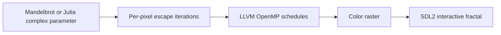

# OpenMP Mandelbrot

## Showcase in action: science and architecture

### Why this example matters

A single quadratic recurrence produces an infinitely intricate boundary. The viewer samples that mathematics at finite resolution, colors escape times and compares OpenMP scheduling policies over uneven pixel workloads.

### The demonstration

Zoom the Mandelbrot boundary, switch to Julia mode, change iteration limit, and compare serial/static/dynamic/guided scheduling while preserving the same fractal parameters.

### Mathematical and technical foundations

$$z_{n+1}=z_n^2+c,\quad z_0=0;\qquad \text{escape when }|z_n|>2.$$

The equation provides context for the implemented numerical or rendering path. It is not evidence of runtime success or a claim that a simplified model represents every possible physical case.

### Native data flow and dependencies

All package/library identities remain those declared in the existing showcase manifest. Existing build and verification instructions below are retained.

---

**Test purpose:** Computes the Mandelbrot fractal in parallel and presents the evolving image through SDL2.

This independent BuildEngine-Tests project exercises **llvm-openmp, SDL2** with native BCC64X/C++23 consumer code. Its source and its runtime dependency closure are defined by this directory's CMake/IDE configuration and the BuildEngine package catalog.

**Programs:** openmp_mandelbrot_benchmark, openmp_mandelbrot_viewer.

See [build.md](build.md), [LICENSE.md](LICENSE.md), [SBOM.md](SBOM.md) and the generated machine-readable CycloneDX declaration for each program. This page is test documentation, not a statement of verified production suitability.

## Applications and interactive operation

**`openmp_mandelbrot_benchmark.exe`** — Deterministic serial/static/dynamic/guided numerical benchmark.

**`openmp_mandelbrot_viewer.exe`** — Interactive SDL2 Mandelbrot and Julia explorer.

Mouse wheel zooms; arrows pan. 1/2/3/4 select serial/static/dynamic/guided OpenMP scheduling; J switches Mandelbrot/Julia; PageUp/PageDown doubles/halves iteration limit; +/- adjusts thread count; R resets the current fractal; Esc exits. The window title displays effective thread count, CPU time and current parameters.
