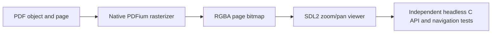

# PDFium viewer SDL2

## Showcase in action: science and architecture

### Why this example matters

Follow a document from actual PDFium parsing and page rasterization into an interactive SDL2 page viewer. Zoom, pan and page controls have real content behind them; a separate C API test checks rendering without UI.

### The demonstration

Open a PDF, navigate boundaries and change zoom from fit through controlled percentages. Compare the C API rasterization and independent page-scroll regression, not just whether a window opens.

### Mathematical and technical foundations

$$s_{\rm display}=s_{\rm fit}\cdot\frac{z}{100},\qquad 50\le z\le 600.$$

The equation provides context for the implemented numerical or rendering path. It is not evidence of runtime success or a claim that a simplified model represents every possible physical case.

### Native data flow and dependencies

All package/library identities remain those declared in the existing showcase manifest. Existing build and verification instructions below are retained.

---

**Test purpose:** Displays PDF pages and verifies native PDFium rendering/API behavior and page navigation.

This independent BCC64X/C++23 BuildEngine-Tests project consumes **PDFium 2025.11.19, SDL2 2.32.10 and Skia 153**. The exact transitive runtime closure is defined in [CMakeLists.txt](CMakeLists.txt) and resolved through versioned BuildEngine packages.

**Programs:** `pdfium-sdl2-viewer` (interactive GUI), `pdfium-c-api-test` (headless C API plus rendering regression), and `pdfium-page-scroll-test` (navigation regression without PDFium or SDL2).

The two noninteractive executables are registered with CTest for Debug and Release. The executable runtime stage preserves exact package versions, rejects DLL collisions, excludes retired Abseil/Skia binaries, and deploys Skia 153's `icudtl.dat` to PDFium-based executables.

See [README.md](README.md), [build.md](build.md), [LICENSE.md](LICENSE.md), and [SBOM.md](SBOM.md). Native Windows execution remains **[nicht verifiziert]**.

## Applications, execution modes and controls

**`pdfium-sdl2-viewer.exe`** — Native PDFium + SDL2 PDF viewer with page selection, zoom, viewport scrolling and Windows file selection.

**`pdfium-c-api-test.exe`** — Headless PDFium C API and rasterization checks.

**`pdfium-page-scroll-test.exe`** — Headless deterministic PDF page scrolling and bounds regression.

OPEN or Ctrl+O selects a PDF. PREV/NEXT, page number entry/GO, Left/Right, PageUp/PageDown and Home/End navigate according to scroll boundaries. +/- and Ctrl+wheel zoom (50–600% of fit); Ctrl+0 restores fit. Drag to pan, Shift+wheel pans horizontally, and Esc cancels editing or exits. The API and scrolling tests run separately without a GUI.
