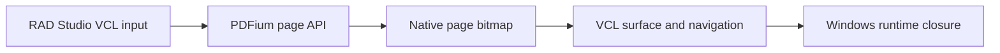

# PDFium VCL viewer

## Showcase in action: science and architecture

### Why this example matters

The same independently packaged PDFium rendering engine can be consumed by a native RAD Studio VCL desktop interface. This is an ABI and ownership demonstration as much as a document viewer.

### The demonstration

Open a real PDF in the VCL program, navigate pages and compare the displayed page with the SDL2 consumer. The VCL project uses its IDE build contract, not a fabricated CMake producer.

### Mathematical and technical foundations

$$\text{document page}\xrightarrow{\text{PDFium rendering}}\text{pixel surface}\xrightarrow{\text{VCL presentation}}\text{desktop view}.$$

The equation provides context for the implemented numerical or rendering path. It is not evidence of runtime success or a claim that a simplified model represents every possible physical case.

### Native data flow and dependencies

All package/library identities remain those declared in the existing showcase manifest. Existing build and verification instructions below are retained.

---

**Test purpose:** Presents PDF document rendering and navigation in a native RAD Studio VCL desktop application.

This independent RAD Studio 13 / Win64x C++23 consumer exercises **PDFium 2025.11.19, Skia 153 and VCL**. The PDFium dependency closure is the same versioned BuildEngine package set used by `pdfium/SDL2`. The VCL IDE application does not use CMake as its build system.

**Program:** `PDFiumVCL`.

See [README.md](README.md), [build.md](build.md), [LICENSE.md](LICENSE.md), and [SBOM.md](SBOM.md). The Windows build, deployment and GUI behavior are **[nicht verifiziert]**.
