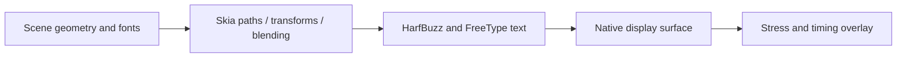

# Direct Skia showcase

## Showcase in action: science and architecture

### Why this example matters

Seven native Skia scenes make the 2D graphics pipeline visible: images, primitives, paths, gradients, transforms and clipping, blending, and a tunable drawing-call stress scene.

### The demonstration

Switch scenes with 1–7, resize or fit, animate then pause, and vary drawing calls in the stress scene. Inspect FPS separately from per-frame CPU rendering time.

### Mathematical and technical foundations

$$\mathbf p' = T\,R\,S\,\mathbf p,\qquad C_{\rm out}=\alpha C_{\rm src}+(1-\alpha)C_{\rm dst}.$$

The equation provides context for the implemented numerical or rendering path. It is not evidence of runtime success or a claim that a simplified model represents every possible physical case.

### Native data flow and dependencies

All package/library identities remain those declared in the existing showcase manifest. Existing build and verification instructions below are retained.

---

**Test purpose:** Demonstrates Skia shapes, text and composited images with the managed graphics DLL and assets.

This independent BuildEngine-Tests project exercises **Skia, FreeType, zlib, bzip2, brotli, JPEG, PNG, HarfBuzz** with native BCC64X/C++23 consumer code. Its source and its runtime dependency closure are defined by this directory's CMake/IDE configuration and the BuildEngine package catalog.

**Programs:** SkiaDirectShowcase.

See [build.md](build.md), [LICENSE.md](LICENSE.md), [SBOM.md](SBOM.md) and the generated machine-readable CycloneDX declaration for each program. This page is test documentation, not a statement of verified production suitability.

## Applications and interactive operation

**`SkiaDirectShowcase.exe`** — Fullscreen Skia rendering showcase with seven scenes and adjustable stress benchmark.

Left/Right or 1–7 chooses Images, Primitives, Paths, Gradients, Transform/Clip, BlendModes or Stress/FPS. F toggles fit-to-screen vs native design pixels; Space pauses/resumes animation; Up/Down adjusts stress load from 2,000 to 40,000 drawing calls in scene 7; R resets; Esc quits. FPS and CPU render time appear in the stress overlay.
