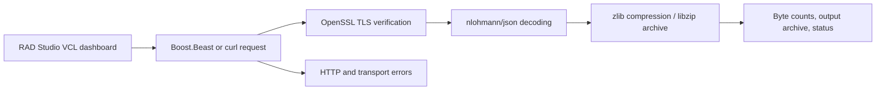

# Third-party integration VCL

## Showcase in action: a complete native integration journey

### Why this is interesting

A polished VCL dashboard is only the visible tip of an integration chain. Pressing the action button runs real HTTPS and JSON requests, manages transport security, compresses bytes and produces a ZIP archive through independently installed native DLLs. This is a demonstration of **binary interoperability and data provenance**, not a mock-up where a painted success icon replaces the network and archive operations.

### What the operator should demonstrate

Use the main VCL action button to start the workflow. Inspect each HTTP status separately, then the parsed structured result, compression size and resulting archive. Compare the reported library/runtime versions with the BuildEngine package declarations. Repeat with an unavailable network endpoint: a real transport failure should remain visible, not be silently replaced by cached success.

### The reversible transformation

Lossless compression and decompression should preserve the payload byte-for-byte:

$$
\operatorname{Decompress}(\operatorname{Compress}(B))=B.
$$

This is a required data invariant; it does not assert a particular compression ratio, which depends on the content.

### Managed native DLL responsibilities

**Evidence boundary:** the external provider must actually respond for an online request to pass. VCL rendering, HTTPS trust, JSON interpretation and ZIP integrity are separate checks. The original testing and runtime instructions remain below.

---

**Test purpose:** Combines VCL user interfaces, HTTPS, JSON, ZIP archives and compression across managed native DLLs.

This independent BuildEngine-Tests project exercises **Boost, OpenSSL, curl, zlib, libzip, nlohmann-json, brotli, zstd, xz** with native BCC64X/C++23 consumer code. Its source and its runtime dependency closure are defined by this directory's CMake/IDE configuration and the BuildEngine package catalog.

**Programs:** ThirdPartyShowcase.

See [build.md](build.md), [LICENSE.md](LICENSE.md), [SBOM.md](SBOM.md) and the generated machine-readable CycloneDX declaration for each program. This page is test documentation, not a statement of verified production suitability.

## Applications, execution modes and controls

**`ThirdPartyShowcase.exe`** — Interactive VCL dashboard for real HTTPS/JSON/zlib/libzip workflow.

The primary action button starts the integration sequence. The dashboard displays individual HTTP results from Boost.Beast/OpenSSL and curl, parsed nlohmann JSON, zlib compression/round-trip and libzip output. It reports statuses, byte counts, runtime versions and the generated archive. Internet access is required; do not claim an offline result.
