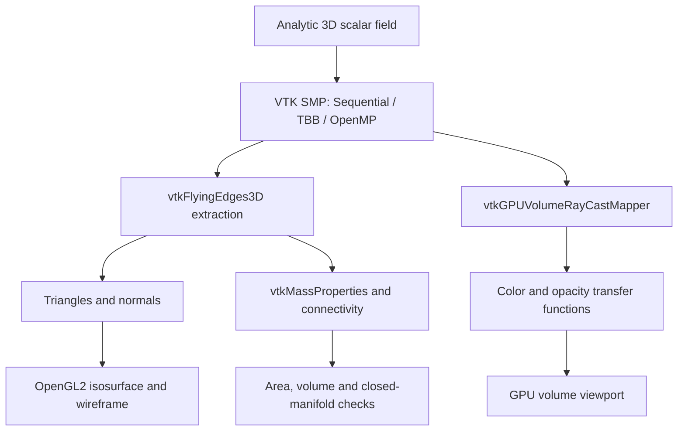

# VTK Scientific Visualization Laboratory

## Showcase in action: from invisible scalar fields to illuminated worlds

### Two ways to see the same mathematics

A three-dimensional scalar field is invisible until a visualization method interprets it. This laboratory presents two fundamentally different views side by side: **VTK FlyingEdges3D** extracts a visible triangulated isosurface, while **VTK GPUVolumeRayCastMapper** samples a full volume using transfer functions. Neither panel is a prerecorded illustration: both are constructed through installed VTK modules and the native OpenGL2 rendering path.

### What makes the demonstration dramatic

Rotate and zoom the smooth, illuminated isosurface and its translucent wireframe in the left viewport. Inspect the luminous volumetric representation in the right viewport. Increase sampling resolution to expose the geometric and computational costs of a finer voxel grid. Then perform independent headless correctness tests with Sequential, TBB and OpenMP backends; do not interpret the appearance of a GPU scene as a passed numerical test.

### Geometry that can be checked

A sphere with radius \(r\) has reference area and volume:

$$
A_{\mathrm{sphere}}=4\pi r^2,\qquad
V_{\mathrm{sphere}}=\frac43\pi r^3.
$$

The existing numerical verifier checks measured mesh area and volume relative to these analytic expectations, with a documented 3.5% tolerance. Closing the surface is separately checked through boundary-edge and connectivity conditions. The artistically deformed presentation field must not be confused with the exact sphere used for this reference comparison.

### Volume and surface pipelines

**Dependency interpretation:** VTK owns the surface and volume rendering algorithms, oneTBB/LLVM OpenMP supply independently selected CPU parallel backends, and OpenGL supplies the platform graphics interface. Screenshot-based evidence requires an actual desktop and GPU context; the numerical CTests do not.

---

**Test purpose:** Interactive analytical isosurfaces and GPU volume rendering with deterministic VTK geometry and TBB/OpenMP stress checks.

A native **VTK 9.7.2 / BCC64X / Win64** interactive 3D visualization with
two live viewports, analytical isosurface geometry, wireframe detail and
GPU volume ray casting. No fake screenshot, static background image,
OpenGL replacement renderer or fallback canvas.

The left view renders an illuminated, deformed 3D isosurface and translucent
wireframe; the right view runs VTK's actual `vtkGPUVolumeRayCastMapper`
using color/opacity transfer functions. Smooth gradient backgrounds and
interactive trackball navigation are provided by VTK RenderingOpenGL2.

The same executable supports headless, deterministic numerical checks:
`vtkSMPTools` fills a regular voxel field, `vtkFlyingEdges3D` extracts a
known sphere, `vtkMassProperties` checks area/volume, connectivity and
feature-edge filters verify manifold closure, and configurable repeated
runs report timings and triangle counts.

`--backend Sequential|TBB|OpenMP` selects native VTK SMP backends;
one backend is used per process. Numerical results are independent of
desktop graphics. GPU screenshot tests require a real Windows graphics
desktop with OpenGL capability; they are opt-in at CMake configure time.
The GPU path is never silently converted into a CPU rasterizer.

See [Build commands](build.md), [License](LICENSE.md) and [SBOM](SBOM.md).

## Applications, execution modes and controls

**`vtk-visualization.exe`** — Interactive dual-viewport VTK scientific isosurface and volume renderer.

The viewer shows side-by-side VTK OpenGL2 isosurface and GPU volume rendering, with native VTK interactor camera controls. Use mouse drag to rotate, wheel to zoom and the VTK interaction gestures to inspect geometry. `--resolution` sets sample density, `--backend` chooses Sequential, TBB or OpenMP. `--verify` performs headless geometric checks, `--stress` repeats computational loads, and `--screenshot` saves a rendered PNG.
